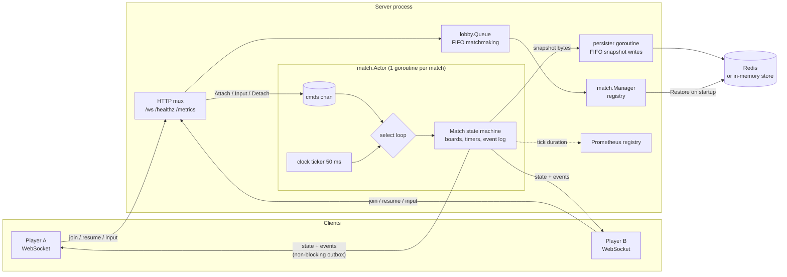
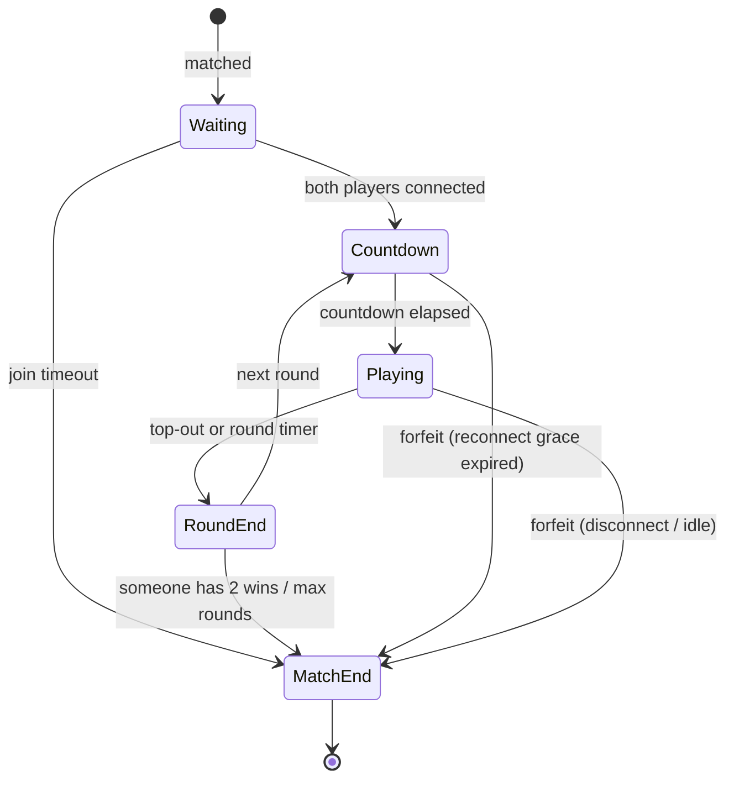

# sabostack-go-server

An open-source **Go reference server** for a real-time 1v1 falling-block PvP game,
modelled on the game loop of **SaboStack**, my published real-time 1v1 PvP game for
browser and Android.

> **What this is and isn't.** SaboStack's production server is written in
> **Node.js/TypeScript** and is not in this repository. This repo is a clean **Go port and
> scaling exploration** of the same server-side concepts: matchmaking, round/match flow,
> server-authoritative timers, garbage attacks, reconnects and crash recovery. It shares
> no code with the production server. All numbers below were measured locally on a
> laptop and say nothing about production traffic.

## What it demonstrates

| Topic | Where | How |
|---|---|---|
| Round/match state machine | `internal/match/phase.go`, `match.go` | Explicit `Waiting → Countdown → Playing → RoundEnd → MatchEnd` with a transition table. Illegal edges return `ErrIllegalTransition` (and panic internally, because they are bugs). |
| Simultaneous player actions | `internal/match/actor.go` | One goroutine per match owns all of its state (actor model). Socket readers send it commands over a channel, so there are no locks around game state. |
| Idempotent inputs | `Match.Input` | Every input carries a per-player `seq`. Anything `<=` the last consumed seq is dropped as a duplicate or stale packet. A seq is consumed even when it's ignored by phase, so a retransmit can't apply in a later round. The seq survives restarts. |
| Timers | `Match.Advance`, `internal/clock` | A server tick (20 Hz) drives gravity, the countdown, the round timer, the round-end pause, the join timeout, the idle timeout and the reconnect grace. All of them are deadlines checked against an injectable `clock.Clock`, so tests use a fake clock and are deterministic. |
| Reconnect | `Match.Attach` | A session token per seat (only its SHA-256 is stored). A client that comes back within the grace window gets a full snapshot plus the events after its `lastEventSeq`, from a bounded event log. The match pauses while someone is away, and all deadlines shift by the pause. |
| Crash/restart recovery | `internal/match/snapshot.go`, `internal/store` | Matches are snapshotted to a pluggable `store.Store`: an in-memory implementation, plus Redis using a key and an id set. Snapshots are taken every second, on every phase change and on graceful shutdown. At startup the server restores them, shifts deadlines by the downtime, and waits for players to resume. |
| Transport | `internal/server` | WebSocket (gorilla/websocket) with a JSON protocol (below) and a FIFO matchmaking queue (`internal/lobby`). Each connection has a non-blocking outbox, and slow consumers are dropped. |
| Ops | `cmd/server`, `internal/metrics` | `/healthz`, Prometheus `/metrics` (active matches, connected players, tick duration histogram, inputs by result, snapshot writes), `slog` JSON logs, and a graceful SIGTERM shutdown that snapshots every match. There's also a Dockerfile and a docker-compose file with Redis. |
| Load tool | `cmd/bot` | Starts N pairs of bots that queue, play random moves and report latency and throughput. |

## Architecture



### Match state machine



While a player is disconnected, `Countdown` and `Playing` are **paused**. Gravity and every
deadline stop, inputs are ignored, and the pause ends when both players are back. If
someone stays away longer than the reconnect grace, they forfeit (or the match is aborted
if both are away).

### Game rules (simplified)

- 10×20 board, seven tetrominoes from a 7-bag. Both players get the same piece sequence each round (same seed).
- Clearing 2/3/4 lines sends 1/2/4 garbage rows. Your own clears cancel incoming garbage first. Pending garbage rises when your next piece locks without a clear.
- A round ends when someone tops out (the opponent wins it), or when the round timer expires (higher score wins; a tie is a drawn round).
- Best of three: first to 2 round wins. A 1–1 after 3 rounds (because of a draw) is a drawn match.

## Protocol

JSON text frames, one object per frame, discriminated by `type`.

### Client → server

| `type` | Fields | Notes |
|---|---|---|
| `join` | `name` | First message: enter the matchmaking queue. |
| `resume` | `matchId`, `token`, `lastEventSeq` | First message: reattach to a match (after a disconnect or a server restart). |
| `input` | `seq`, `action` | `action` ∈ `left`, `right`, `rotate`, `soft_drop`, `hard_drop`. `seq` must increase per player. Gaps are fine; repeats and older values are ignored. |
| `ping` | `t` | Echoed back as `pong`. |

### Server → client

| `type` | Fields | When |
|---|---|---|
| `queued` | | After `join`, while waiting for an opponent. |
| `matched` | `matchId`, `seat` (0/1), `token`, `opponent` | Opponent found. Keep `token` for `resume`. |
| `snapshot` | `matchId`, `seat`, `state`, `events[]`, `eventsComplete` | On every (re)attach. `events` are those after `lastEventSeq`. `eventsComplete=false` means the bounded log no longer reaches that far back (the `state` is still authoritative). |
| `state` | `tick`, `phase`, `round`, `paused`, `remainingMs`, `ack`, `eventSeq`, `players[]` | At most once per server tick, only when something changed. `ack` = highest input `seq` the server consumed from you. Each player has `name`, `connected`, `wins`, `rows[]` (`.` = empty), `piece`, `score`, `lines`, `pending`, `dead`. |
| `event` | `event: {seq, atMs, kind, ...}` | Discrete events: `phase`, `cleared`, `garbage`, `round_over`, `match_over`, `player_left`, `player_back`, `paused`, `resumed`. |
| `error` | `code`, `message` | e.g. `bad_token`, `match_not_found`, `bad_name`, `bad_request`. |
| `pong` | `t` | |

Example session (ids and numbers are illustrative):

```text
→ {"type":"join","name":"alice"}
← {"type":"queued"}
← {"type":"matched","matchId":"9f2c…","seat":0,"token":"4be1…","opponent":"bob"}
← {"type":"snapshot","matchId":"9f2c…","seat":0,"state":{…,"phase":"waiting"},"events":[],"eventsComplete":true}
← {"type":"event","event":{"seq":1,"kind":"phase","phase":"countdown","round":1,"durationMs":3000}}
← {"type":"event","event":{"seq":2,"kind":"phase","phase":"playing","round":1,"durationMs":90000}}
→ {"type":"input","seq":1,"action":"rotate"}
← {"type":"state","tick":64,"phase":"playing","ack":1,"players":[…]}
   … connection drops …
→ {"type":"resume","matchId":"9f2c…","token":"4be1…","lastEventSeq":2}
← {"type":"snapshot",…,"events":[{"seq":3,"kind":"player_left","seat":0},{"seq":4,"kind":"paused"},{"seq":5,"kind":"player_back","seat":0}]}
← {"type":"event","event":{"seq":6,"kind":"resumed"}}
```

## Running it

You need Go 1.22 or newer.

```sh
go run ./cmd/server                      # :8080, in-memory store (no crash recovery)
go run ./cmd/server -redis localhost:6379  # snapshots in Redis; restart resumes matches
go run ./cmd/server -h                   # all timers are flags (countdown, round time, grace, ...)

go run ./cmd/bot -pairs 100              # load test against localhost:8080
```

With Docker (server + Redis):

```sh
docker compose up --build
```

Endpoints: `ws://localhost:8080/ws`, `http://localhost:8080/healthz` and
`http://localhost:8080/metrics`.

To try crash recovery by hand, run the server with `-redis`, start a match (for example
`go run ./cmd/bot -pairs 1 -rate 1`), stop the server with Ctrl+C or SIGTERM, and start it
again. The log shows `match restored`, and clients can `resume` with their token.

## Tests

```sh
go test -race ./...
```

There are 33 tests. All of them pass with `-race`; the server and match packages were also
run 10 times in a row (`-count=10`) to check for flakiness:

- **State machine:** every one of the 25 (from, to) phase pairs is checked against the
  legal table, plus a full best-of-3 flow (top-outs, round reset, terminal `MatchEnd`) and
  gap-free event sequences on both clients.
- **Idempotency:** duplicates, reordered and stale seqs, inputs during countdown that are
  consumed but not applied, and the seq surviving a snapshot restore. A concurrent test has
  both players hammer the actor with duplicate inputs under `-race`.
- **Timers with a fake clock:** gravity, gravity catch-up after a late tick, the round
  timer deciding by score, the join timeout, the idle timeout, the reconnect grace, and a
  pause that shifts deadlines. The actor tests drive the real goroutine with
  `clock.Fake.Advance`.
- **Recovery:** a snapshot restore shifts deadlines by the downtime. A `Manager` restart on
  a shared store resumes the match, and a finished match is deleted from the store.
- **Store:** the same contract runs against the memory store and against Redis via
  [miniredis](https://github.com/alicebob/miniredis), including TTL expiry cleanup.
- **Integration (`internal/server`):** two real WebSocket clients play a full match through
  `httptest`: matchmaking, a mid-round disconnect, a resume that returns exactly
  `player_left, paused, player_back`, a rejected wrong token, then both rounds to
  `match_over`. A second test stops the whole server mid-match, starts a new one on the
  same store, and resumes both players there; the pre-restart `seq` is still deduplicated.

## Benchmark (measured locally)

Setup: the server and `cmd/bot` were built as Linux binaries and run **on the same machine**
inside WSL2 Ubuntu (8 vCPUs, Intel i9-10885H laptop, Windows 11 host). Both use the
loopback interface and in-memory snapshots. Server flags were `-countdown 1s
-round-end-pause 1s` (the other timers at their defaults: 50 ms tick, 500 ms gravity).
Each bot sends 10 random inputs per second, a third of them hard drops, so every match
finishes by top-outs in about 12–15 s. Every run below finished all of its matches with
zero bot errors.

| Pairs (bots) | Wall time | Inputs sent | Msgs received | Input→ack p50 / p95 / p99 / max | Mean tick CPU | Ticks ≤ 50 µs | Server RSS |
|---|---|---|---|---|---|---|---|
| 100 (200) | 13.7 s | 9,383 (686/s) | 17,898 | 27.2 / 48.1 / 50.3 / 52.5 ms | 7.2 µs | 99.16 % | 27 MB |
| 500 (1,000) | 15.1 s | 48,851 (3,236/s) | 90,160 | 27.2 / 48.0 / 50.2 / 57.8 ms | 5.8 µs | 99.21 % | 76 MB |
| 1,000 (2,000) | 16.2 s | 97,575 (6,014/s) | 182,706 | 26.1 / 48.9 / 54.5 / 95.0 ms | 19.0 µs | 98.97 % | 128 MB |

How to read it:

- **Input→ack latency** is the time from the bot sending an input to receiving the first
  `state` that acknowledges it. The server deliberately batches inputs and broadcasts once
  per 50 ms tick, so most of this is the tick wait: about 25 ms on average and 50 ms at
  worst, plus loopback and JSON. A server that broadcast on every input would show lower
  numbers but send more messages.
- **Tick CPU** is the time one match goroutine spends in a tick (timers, gravity, building
  `state`). JSON encoding happens in the per-connection writer goroutines, so it isn't
  included. The rise at 1,000 pairs, and the max latency, mostly reflect 2,000 bot
  goroutines competing for the same 8 vCPUs as the server.
- Server RSS was read from `process_resident_memory_bytes` at the end of each run.
- On native Windows the Go monotonic clock is too coarse to time a microsecond tick (the
  histogram reads 0), so I took the benchmark numbers under WSL2.

I didn't run a larger load or a multi-machine test, and I didn't benchmark the Redis store
(no Redis instance was used for these runs).

## Design notes and limitations

- **One match = one goroutine.** This makes simultaneous inputs trivial: they are
  serialised in arrival order, and the game logic (`Match`) is plain synchronous code that
  is easy to unit-test. Cross-match state is only the registry map (under a mutex) and the
  matchmaking queue.
- **Never block the match loop on I/O.** Client sends go to a bounded outbox (a slow
  client is disconnected and can resume). Periodic snapshots go to a single FIFO persister
  goroutine and are dropped if it's backed up (the next snapshot supersedes them). Final
  snapshots and deletes wait for the write. Because all writes share one queue, a late
  periodic snapshot can never overwrite a final one or resurrect a finished match.
- **Single node.** A match lives in exactly one process. Scaling out would need routing by
  `matchId` (sticky sessions or a match directory) and a shared matchmaking queue; the
  snapshot store already allows a match to move to another process after a restart.
- **Not covered:** authentication and accounts, ratings, anti-cheat beyond the server being
  authoritative, origin checks (`CheckOrigin` accepts all origins), TLS and rate limiting.
  The game rules are simplified (no hold piece, no SRS kicks, no lock delay).
- The Dockerfile and compose file are provided but weren't built or run while writing this
  README.

## Layout

```text
cmd/server        server binary: flags, slog, Redis/memory store, graceful shutdown
cmd/bot           load generator
internal/clock    Clock interface, real clock, deterministic fake clock
internal/game     board, pieces, 7-bag, line clears, garbage (pure, deterministic)
internal/match    state machine (Match), actor goroutine (Actor), Manager, snapshots
internal/lobby    FIFO matchmaking queue
internal/store    Store interface, memory and Redis implementations
internal/server   WebSocket handler, per-connection writer/reader, HTTP routes
internal/protocol JSON message types
internal/metrics  Prometheus collectors
```

## License

MIT
