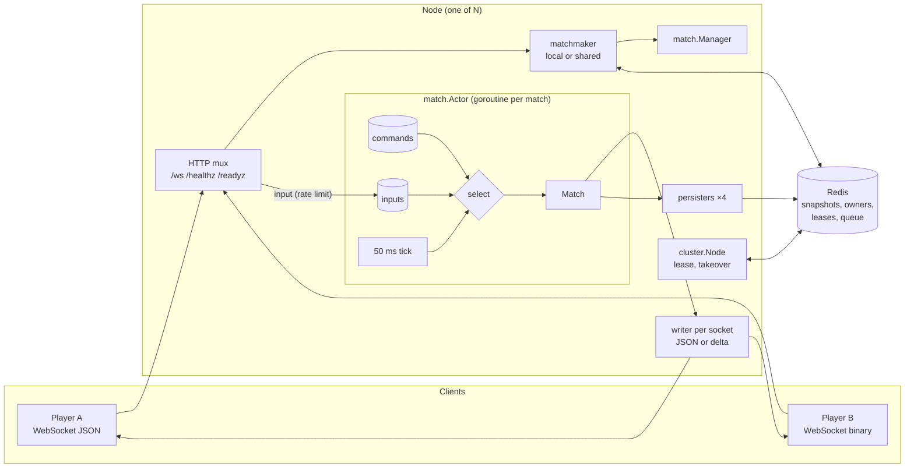
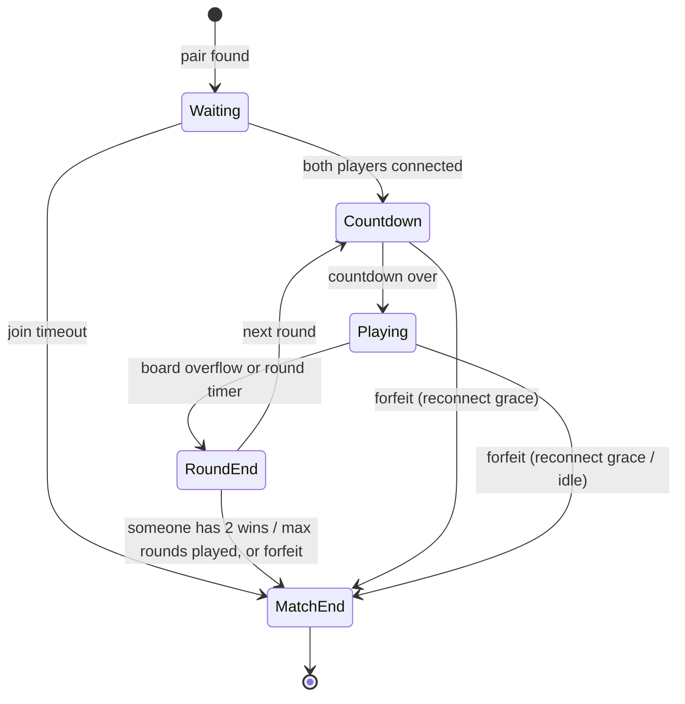

# sabostack-go-server

[](https://github.com/Gegirhasut/sabostack-go-server/actions/workflows/ci.yml)

**English** | [Русский](README.ru.md)

A Go game server for real-time 1v1 PvP with falling blocks: an authoritative server, the
actor model, a binary delta protocol, reconnection without losing the match, recovery
after a process crash, and a multi-node cluster that survives a node dying mid-game.

It is the server of **[SaboStack](https://play.google.com/store/apps/details?id=com.sabostack.app)**,
my real-time PvP game for browser and Android, published on Google Play (5K+ downloads).

## Numbers at a glance

One laptop, WSL2 with 8 vCPUs, server and bots on the same machine (methodology in
[LOAD_TESTING.md](docs/LOAD_TESTING.md)):

- **4,000 WebSocket connections (2,000 matches)** with no errors: input→ack p95 ≈ 50 ms.
  That is almost exactly one server tick: the server batches inputs on purpose and
  broadcasts state every 50 ms.
- **Binary delta protocol:** a state frame is 14 bytes instead of 926, encoded in 535 ns
  with zero allocations instead of 7.6 µs. Server-to-client traffic under load is
  **18× lower**, server CPU 5–9 % lower ([WIRE.md](docs/WIRE.md)).
- **Cluster:** a node killed with SIGKILL under load — **188 of 188 players got back into
  their matches** on other nodes (within 7–13 s, depending on when the node died), 0
  errors. On a rolling deploy (SIGTERM): 206 of 206 within 3.9 s, with no lost progress
  ([CLUSTER.md](docs/CLUSTER.md)).
- **~76 KB of memory and ~0.05 % of a core per player.** CPU is the limit, not memory.
- **123 tests and 2 fuzz targets, all passing under `-race`.** 13 tests reproduce bugs
  found while hardening: each fails on the code before the fix and passes after it
  ([HARDENING.md](docs/HARDENING.md)). 31 more cover defects found later
  ([HARDENING.md](docs/HARDENING.md#найдено-позже)). The store and cluster tests run
  against both miniredis and a real Redis. The load bot checks protocol invariants on
  every frame: 0 violations in the final runs.

## Documentation

The detailed documents are in Russian.

| Document | Contents |
|---|---|
| [ARCHITECTURE.md](docs/ARCHITECTURE.md) | Components, state machine, actor model, timers, reconnection, recovery. |
| [WIRE.md](docs/WIRE.md) | Binary protocol: frame format, where deltas are computed, how correctness is checked, measurements. |
| [CLUSTER.md](docs/CLUSTER.md) | Multiple nodes: liveness, match takeover, fencing, shared matchmaking, the node-kill demo. |
| [HARDENING.md](docs/HARDENING.md) | What went wrong under load and under attack, a test for every bug, memory profiling. |
| [LOAD_TESTING.md](docs/LOAD_TESTING.md) | Methodology, steps up to 6,000 connections, capacity, soak, reconnect storm, version and protocol comparisons. |

## What the project demonstrates

| Topic | Where | How |
|---|---|---|
| State machine | `internal/match/phase.go`, `match.go` | An explicit `Waiting → Countdown → Playing → RoundEnd → MatchEnd` chain with a transition table. An illegal transition is a bug: a panic inside, `ErrIllegalTransition` outside. |
| Simultaneous actions | `internal/match/actor.go` | One goroutine per match owns its state; there are no locks around game logic. Both players' inputs are applied in arrival order, each seat has its own limit, so a flooder cannot crowd out the opponent. |
| Idempotency | `Match.Input` | Every input carries a `seq`; duplicates and stale ones are dropped. The seq survives a restart and a takeover by another node. |
| Binary protocol | `internal/wire`, `internal/server/conn.go` | Subprotocol `sabostack.bin.v1`. The delta is computed in the writer goroutine against what was *actually* sent to the client, so it stays consistent with outbox conflation and reconnects. Fuzzing found and closed a decoder crash. |
| Timers | `Match.Advance`, `internal/clock` | 20 Hz tick; every timer is a deadline on a swappable clock, so tests are deterministic. |
| Reconnection | `Match.Attach`, `Match.Advance` | A session token (only its SHA-256 is stored); the first message is a snapshot with the missed events. The match never pauses: a dropped player's board keeps falling while the opponent plays on, and they have 20 s to resume or forfeit. |
| Connection loss | `Match.Advance`, `internal/server/conn.go` | A half-open connection is noticed by silence, by the match on its own tick: 8 s without a message or a pong marks the seat away and starts the grace, while the socket stays open in case the client was only slow. It comes back after 4 s of steady contact (hysteresis, so a stalling connection does not flap). What a client does on its side: [client contract](docs/ARCHITECTURE.md#контракт-клиента--потеря-соединения). |
| Crash recovery | `snapshot.go`, `manager.go` | Snapshots are written by several persisters with coalescing and pipelined batches, behind a circuit breaker for Redis outages. After a rewind to a snapshot, event numbers are never reused. |
| Cluster | `internal/cluster`, `internal/store/cluster.go` | A one-key lease per node, batched takeover of a dead node's matches under a lock, Lua fencing of the owner, self-fencing on Redis loss, a shared matchmaking queue with pub/sub and redirects. |
| Fault isolation | `Actor.run` | A panic in one match stops only that match. |
| Client protection | `internal/server` | Token bucket before decoding, connection limits, Origin checks, name validation, `state` frame conflation for slow clients. |
| Operations | `cmd/server`, `internal/metrics` | `/healthz`, `/readyz`, draining, an admin port with `/metrics` and pprof, traffic and disconnect reasons in metrics, JSON logs, Docker and compose for 1 and 3 nodes. |
| Load | `cmd/bot`, `cmd/loadreport`, `scripts/` | The bot plays both protocols, checks invariants, moves between nodes and survives their death. `loadreport` builds tables from raw JSON (medians over repeated runs). |

## Architecture



### Match state machine



A disconnect never pauses the match: the player with a good connection never waits for
one with a bad connection. While a player is disconnected, their board keeps falling (pieces lock,
incoming garbage rises, a top-out loses the round), the round timer keeps running and the
opponent keeps playing. The disconnected player resumes from whatever their board is by
then, or forfeits if they are not back within the reconnect grace (20 s). If both are away
and both graces run out on the same tick, nobody wins (`both_disconnected`); otherwise each
player's grace is their own. The idle timeout (30 s without input) counts only connected
time, so it never fires for a player the grace is already counting. The one stand-still
is the server's own: after a restart or a failover both players have to find the new node,
so a restored match stands still (`paused`) until both are back, for at most 10 s
(`-resync-wait`); otherwise whoever's client reconnected first would win the round.
Details in [ARCHITECTURE.md](docs/ARCHITECTURE.md#отключения-матч-не-ждёт).

### Game rules (simplified)

- 10×20 board, seven tetrominoes from a 7-bag; in each round both players get the same
  piece sequence.
- Clearing 2, 3 or 4 lines sends the opponent 1, 2 or 4 garbage rows; your own clears
  cancel incoming garbage first.
- A round ends on board overflow or by timer. The match is best of three (first to two
  wins).

## Protocol

JSON frames with the type in the `type` field. A client that asks for the WebSocket
subprotocol `sabostack.bin.v1` receives `state` and `pong` as binary deltas and may send
`input` and `ping` in binary. The format is described in [WIRE.md](docs/WIRE.md).

### Client → server

| `type` | Fields | Notes |
|---|---|---|
| `join` | `name` | First message: join the queue. Name: 1–24 printable characters. |
| `resume` | `matchId`, `token`, `lastEventSeq` | First message: return to a match after a dropped connection, a restart or a move to another node. |
| `input` | `seq`, `action` | `left`, `right`, `rotate`, `soft_drop`, `hard_drop`. `seq` increases; duplicates are ignored. |
| `ping` | `t` | Echoed as `pong`. |

Client messages go through a token bucket (40/s, burst 20). A persistent flooder is
disconnected with `rate_limited`.

### Server → client

| `type` | Fields | When |
|---|---|---|
| `queued` | | After `join`. |
| `matched` | `matchId`, `seat`, `token`, `opponent`, `url` | Opponent found. If `url` is set, the match runs on another node: connect there and `resume`. |
| `snapshot` | `matchId`, `seat`, `state`, `events[]`, `eventsComplete` | Always the first message after attaching to a match. `eventsComplete=false` means the client's history is invalid (the log is shorter, or the match rewound to a snapshot after a node crash): trust `state`, resend unacknowledged inputs. |
| `state` | `tick`, `phase`, `round`, `paused`, `remainingMs`, `ack`, `eventSeq`, `players[]` | At most once per tick, and only on change. An unsent `state` is replaced by a newer one. `paused` is `true` only while a restored match waits for its players after a restart or failover (`remainingMs` stands still, inputs are not applied); a disconnect never pauses a match. `players[i].connected` is `false` while that player is away. |
| `event` | `event: {seq, atMs, kind, ...}` | `phase`, `cleared`, `garbage`, `round_over`, `match_over`, `player_left`, `player_back`, `resumed` (a restored match runs again). Never lost or reordered. `paused` is no longer sent; ignore unknown kinds. |
| `error` | `code`, `message`, `url` | `wrong_server` (reconnect to `url`), `match_moving` (the match's node died and it is being taken over — retry), `match_not_found`, `bad_token`, `rate_limited`, `unavailable`, `bad_name`, `bad_request`, `bad_json`, `timeout`. |
| `pong` | `t` | |

`match_over` reasons: `rounds`, `draw`, `opponent_disconnected`, `both_disconnected`,
`opponent_idle`, `both_idle`, `disconnected_and_idle`, `opponent_never_joined`,
`internal_error`.

```text
→ {"type":"join","name":"alice"}
← {"type":"queued"}
← {"type":"matched","matchId":"9f2c…","seat":0,"token":"4be1…","opponent":"bob"}
← {"type":"snapshot","matchId":"9f2c…","seat":0,"state":{…,"phase":"waiting"},"events":[],"eventsComplete":true}
← {"type":"event","event":{"seq":1,"kind":"phase","phase":"countdown","round":1,"durationMs":3000}}
← {"type":"event","event":{"seq":2,"kind":"phase","phase":"playing","round":1,"durationMs":90000}}
→ {"type":"input","seq":1,"action":"rotate"}
← {"type":"state","tick":64,"phase":"playing","ack":1,"players":[…]}
   … connection dropped …
→ {"type":"resume","matchId":"9f2c…","token":"4be1…","lastEventSeq":2}
← {"type":"snapshot",…,"state":{…,"phase":"playing"},"events":[{"seq":3,"kind":"player_left","seat":0},{"seq":4,"kind":"garbage","seat":0,"garbage":1},{"seq":5,"kind":"player_back","seat":0}]}
```

## Running

Requires Go 1.25 or newer.

```sh
go run ./cmd/server                        # :8080, in-memory store
go run ./cmd/server -redis localhost:6379  # snapshots in Redis: matches continue after a restart
go run ./cmd/server -h                     # all flags

go run ./cmd/bot -pairs 100                # one match per pair
go run ./cmd/bot -pairs 500 -duration 60s -proto bin   # sustained load, binary protocol
```

Docker:

```sh
docker compose up --build                                          # one node and Redis
docker compose -f docker-compose.cluster.yml up --build            # three nodes and Redis
docker compose -f docker-compose.cluster.yml run --rm bot          # load through all nodes
scripts/cluster-failover.sh                                        # kill a node under load
scripts/cluster-failover.sh 300 35 SIGTERM                         # roll a node under load
```

A cluster without Docker: each node has its own `-node-id` and `-public-url`, and they
share `-redis`:

```sh
go run ./cmd/server -addr :8081 -redis localhost:6379 -node-id game-1 -public-url ws://localhost:8081/ws
go run ./cmd/server -addr :8082 -redis localhost:6379 -node-id game-2 -public-url ws://localhost:8082/ws
```

Main production flags:

| Flag | Default | Purpose |
|---|---|---|
| `-admin-addr` | off | `/metrics` and `/debug/pprof` on an internal address. |
| `-allowed-origins` | any | Allowed browser Origins. |
| `-max-conns`, `-max-conns-per-ip` | off | Connection limits. |
| `-trusted-proxies` | 0 | How many of our proxies stand in front of the server. The client IP is that many `X-Forwarded-For` entries from the right. |
| `-input-rate`, `-input-burst` | 40, 20 | Token bucket for client messages. |
| `-node-id`, `-public-url`, `-lease`, `-shared-queue` | off, —, 10 s, on | Cluster ([CLUSTER.md](docs/CLUSTER.md)). |
| `-drain-timeout` | 0 | On SIGTERM, stop matchmaking and let running matches finish. |
| `-reconnect-grace`, `-idle-timeout`, `-resync-wait` | 20 s, 30 s, 10 s | Disconnect rules ([ARCHITECTURE.md](docs/ARCHITECTURE.md#отключения-матч-не-ждёт)). The server refuses to start with timings that break them (a drop noticed only after the idle timeout, pings too rare for the silence timeout, a resync wait not under the grace). |
| `-ping-interval`, `-silence-timeout`, `-pong-wait` | 2 s, 8 s, 30 s | Heartbeat: a client heard nothing from for 8 s is marked away, its socket is closed after 30 s. Why these values: [HARDENING.md](docs/HARDENING.md#heartbeat-тишина-8-с-обрыв-30-с). |

### Production checklist

The defaults suit local runs and load tests from a single IP. The server logs a warning
at startup for every unsafe default.

- [ ] `-allowed-origins` — the web client's domains. Otherwise a page on any site can open
      a WebSocket on a player's behalf.
- [ ] `-max-conns-per-ip` and `-max-conns`. Behind a load balancer, also `-trusted-proxies`
      with the number of proxies, or every client will have the balancer's IP. With
      `-trusted-proxies` the server port must be reachable **only** by the proxies
      (firewall, private network): a client connecting directly would forge
      `X-Forwarded-For`.
- [ ] `-admin-addr` on an internal interface and `-public-metrics=false`: `/metrics` and
      `/debug/pprof` must not be visible from outside.
- [ ] `-redis`, and for several nodes also a `-node-id` and `-public-url` for each. Without
      Redis, matches do not survive a restart.
- [ ] `-drain-timeout` at least as long as a match, and the orchestrator's
      `terminationGracePeriod` longer than that. Readiness probes on `/readyz`.
- [ ] TLS at the load balancer (`wss://`). The server does not terminate TLS itself.

## Tests

```sh
go test -race ./...
go test -run '^$' -fuzz FuzzDecodeState ./internal/wire
```

[CI](.github/workflows/ci.yml) on every push:
- `gofmt`, `go mod tidy`, `go vet`, `staticcheck`, `govulncheck`;
- `go test -race -count=2` on the minimum Go version from `go.mod` and on the current one;
- the store, cluster, server and match-takeover tests against a real Redis 7 instead of miniredis
  (`SABO_TEST_REDIS=host:port/15 go test -p 1 ./internal/store ./internal/cluster ./internal/server ./internal/match`;
  every test flushes the given database, so the database number is required and
  database 0 is refused);
- 30 s of fuzzing for each decoder;
- a Docker image build and a run with a `/healthz` check.

123 tests and 2 fuzz targets. The concurrency and cluster tests were run many times
(`-count=20…300`) to rule out flakiness.

- **Bug reproductions (13):** every bug found while hardening is covered by a test written
  against the old API: it fails with a meaningful message on the code before the fix and
  passes after it ([table](docs/HARDENING.md#баги-и-их-воспроизведение)).
- **Defects found later (31):** IP spoofing via `X-Forwarded-For`, extra time before an
  idle forfeit after reconnecting, self-fencing before the lease expires, retrying an
  unsaved snapshot, a leaving node is no redirect target, `pong` while queued, no double
  assignment in matchmaking, a `WaitGroup` race at shutdown, a zombie match on a fenced
  node, leaked tickets of players who left, a ghost ticket in the queue, a match is
  announced only after it is stored, snapshots of an unknown version are not deleted
  during a rollout, player tokens never reach Redis, a restored match waits for both
  players, a stalling connection does not flap away/back, timing flags are checked at
  startup, the snapshot version is bumped with a migration
  ([HARDENING.md](docs/HARDENING.md#найдено-позже)).
- **Binary protocol:** 20,000 random round-trip steps, byte-for-byte equality of
  delta-built fields with the authoritative snapshot over a real WebSocket, fuzzing of
  both decoders, benchmarks.
- **Cluster:** takeover, fencing of a returning zombie, batches, `Release`, a pair of
  players from different nodes, a lost assignment, a Redis outage longer than the lease,
  two real servers where the owning node dies mid-round and the match finishes on the
  other.
- **Game and protocol:** transition table, a full match, idempotency under `-race`,
  timers on a fake clock, restore with shifted deadlines, message order on `resume`, a
  rewind after a crash without reusing event numbers.
- **Disconnects (fake clock):** the opponent plays on and the round timer runs while a
  player is away, the away board falls and tops out, a resume sees the board as it is now,
  the grace running out (also between rounds), both players away, idle time vs the grace,
  restore and a takeover over Redis with a player away, a restored match waiting for both
  players (and only up to `-resync-wait`), version-1 snapshots migrated, a silent
  connection marked away and back only after steady contact, grace and idle on one tick,
  timing flags checked at startup.
- **Transport and operations:** flooding, outbox conflation, Origin, per-IP limit,
  draining, redirect to the owner, admin port, malformed frames, silence detection (on a
  fake clock, and by pongs over real sockets).

## Load testing (summary)

Methodology and raw data are in [docs/LOAD_TESTING.md](docs/LOAD_TESTING.md). Server and
bots on one laptop under WSL2 (8 vCPUs, i9-10885H), loopback, with unrelated load running
alongside. Each bot sends 10 inputs per second and rejoins the queue after a match.

JSON protocol, medians over runs (raw data in `docs/loadtest/hardening/`):

| Pairs | Connections | Server RSS | Server CPU | Input→ack p50 / p95 / p99 | Errors / drops |
|---:|---:|---:|---:|---:|---:|
| 500 | 1,000 | 106 MB | 92 % of a core | 25.6 / 48.4 / 50.4 ms | 0 / 0 |
| 1,000 | 2,000 | 187 MB | 150 % of a core | 25.6 / 48.4 / 50.6 ms | 0 / 0 |
| 2,000 | 4,000 | 339 MB | 255 % of a core | 28.2 / 61.7 / 132 ms | 0 / 0 |
| 3,000 | 6,000 | 479 MB | 330 % of a core | 32.1 / 96.0 / 198 ms | 0 / 0 |

These runs used the old heartbeat (a ping every 20 s). Pinging every 2 s, as the server
now does, was measured against it on the same bench: within noise at 1,000 pairs, about
+4 % server CPU at 2,000 pairs (4,000 connections), memory unchanged, no errors
([HARDENING.md](docs/HARDENING.md#стоимость-пингов-раз-в-2-с)).

Binary protocol on the same steps (medians, [WIRE.md](docs/WIRE.md#под-нагрузкой)):

| Pairs | Traffic per client: JSON → deltas | Server CPU: JSON → deltas | p95: JSON → deltas |
|---:|---:|---:|---:|
| 1,000 | 3.65 → **0.20 KB/s** | 171 → 162 % | 49 → 49 ms |
| 2,000 | 3.72 → **0.20 KB/s** | 269 → 247 % | 161 → 84 ms |
| 3,000 | 3.65 → **0.20 KB/s** | 312 → 314 % | 154 → 135 ms |

- Input→ack latency is mostly the deliberate wait for the tick: half a tick on average,
  never more than one tick.
- At 3,000 pairs the shared machine saturates: server and bots share 8 vCPUs, and the
  latency tail is set by competition for CPU, not by the server.
- Soak, 1,000 pairs × 5 min: RSS and goroutines stay flat. Reconnect storm (20 % of
  clients): 100 % got back into their matches. A 3-node cluster with Redis under load,
  with a node killed — in [CLUSTER.md](docs/CLUSTER.md#демо-узел-убит-под-нагрузкой).

## Decisions and limitations

- **One match, one goroutine.** Game logic is synchronous code that is easy to test. The
  match loop never waits on I/O: sending to clients, Redis and the network all go through
  queues.
- **Only the hot messages are binary** (`state`, `input`): they are nearly all the
  traffic. Rare messages stay JSON for readability.
- **The match never waits for a disconnected player.** In PvP the player with a good
  connection must not pay for the opponent's bad one. The cost falls on the one who
  dropped: their board runs without them until they are back (a typical reconnect takes
  a few seconds).
- **Safety over availability under a partition:** a node that loses Redis for longer than
  its lease stops its matches and brings them back once Redis returns.
- **Limitations:**
  - The cluster needs a single Redis (or Sentinel), not Redis Cluster: the Lua scripts
    touch keys in different slots.
  - After a hard node crash, a match rewinds to its last snapshot (up to 1 s of progress).
  - No authentication, rating or anti-cheat beyond the authoritative server and the
    limits.
  - The game rules are simplified: no hold, SRS kicks or lock delay.

## Layout

```text
cmd/server        server: flags, Redis/memory, cluster, draining, graceful shutdown
cmd/bot           load bot: JSON and binary, invariant checks, cluster-aware
cmd/loadreport    tables and charts for docs/LOAD_TESTING.md from raw JSON
internal/clock    Clock interface, real and fake clocks
internal/game     board, pieces, 7-bag, lines, garbage (pure deterministic logic)
internal/match    state machine, actor, Manager, persisters, snapshots
internal/lobby    local FIFO matchmaking queue
internal/cluster  node lease, match takeover, shared matchmaking over Redis
internal/store    Store; memory, Redis, node mode with fencing, directory and leases
internal/wire     binary protocol: delta codec, fuzz tests
internal/server   WebSocket, JSON and binary writers, rate limit, limits, health/ready/admin
internal/protocol JSON message types
internal/metrics  Prometheus collectors
docs/             documentation and raw load results (docs/loadtest/)
scripts/          load steps, version and variant comparisons, node-failure demo
```

## License

MIT
