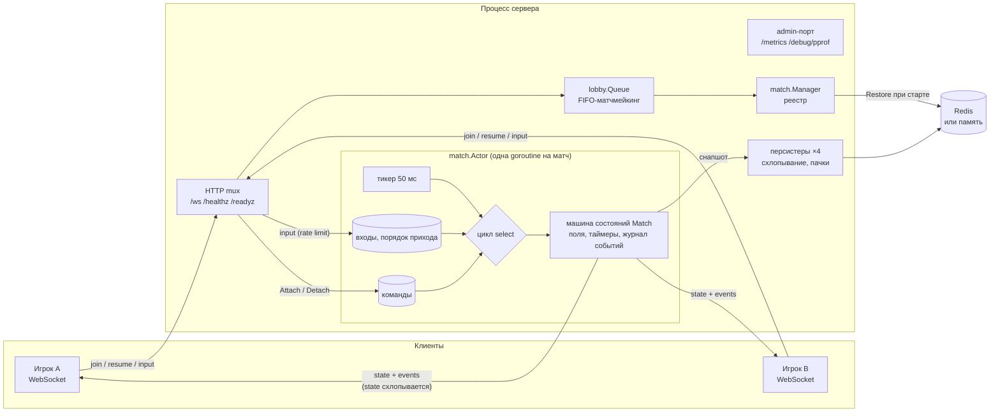
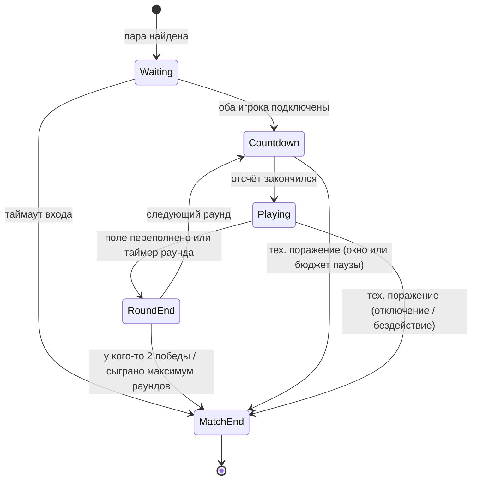

# sabostack-go-server

Игровой сервер на Go для real-time PvP 1 на 1 с падающими блоками. Авторитетный сервер,
модель акторов, переподключение без потери матча, восстановление после падения процесса,
защита от злонамеренных клиентов и несколько узлов на одном Redis.

Он повторяет игровой цикл
**[SaboStack](https://play.google.com/store/apps/details?id=com.sabostack.app)** — моей
real-time PvP-игры для браузера и Android, опубликованной в Google Play (5K+ скачиваний).

> **Что это, а что нет.** Продакшен-сервер SaboStack написан на **Node.js/TypeScript** и в
> этом репозитории его нет. Здесь — **порт на Go и исследование масштабирования** тех же
> серверных идей. Кода с продакшен-сервером здесь нет. Все цифры ниже измерены на одном
> ноутбуке и ничего не говорят о продакшен-трафике.

**Коротко в цифрах** (ноутбук, WSL2 8 vCPU, сервер и боты на одной машине, см.
[нагрузочное тестирование](docs/LOAD_TESTING.md)):

- **4000 WebSocket-подключений (2000 матчей):** 0 ошибок, input→ack p95 ≈ 50 мс. Это почти
  ровно один серверный тик: сервер намеренно копит входы и рассылает состояние раз в 50 мс.
- **~76 КБ памяти и ~0,05 % ядра на игрока.** Ограничивает CPU, а не память.
- **Шторм переподключений:** 20 % клиентов одновременно рвут сокет посреди матча, 100 %
  возвращаются в свой матч.
- **64 теста (было 33), все проходят с `-race`.** Из них 13 воспроизводят найденные баги: они
  падают на коде до исправления и проходят после ([таблица](docs/HARDENING.md)).

Документация:

- [docs/ARCHITECTURE.md](docs/ARCHITECTURE.md) — компоненты, машина состояний, модель
  акторов, таймеры, переподключение, восстановление, несколько узлов.
- [docs/HARDENING.md](docs/HARDENING.md) — что было не так под нагрузкой и под атакой,
  как исправлено, тест на каждый баг, профилирование памяти, сравнение «до/после».
- [docs/LOAD_TESTING.md](docs/LOAD_TESTING.md) — методика, ступенчатая нагрузка до 6000
  подключений, ёмкость, soak-тест, шторм переподключений, сырые результаты.

## Что демонстрирует проект

| Тема | Где | Как |
|---|---|---|
| Машина состояний раунда и матча | `internal/match/phase.go`, `match.go` | Явная цепочка `Waiting → Countdown → Playing → RoundEnd → MatchEnd` с таблицей переходов. Недопустимый переход — баг, внутри кода это паника, наружу `ErrIllegalTransition`. |
| Одновременные действия игроков | `internal/match/actor.go` | Одна goroutine на матч единолично владеет его состоянием (модель акторов), поэтому вокруг игровой логики нет блокировок. Входы обоих игроков применяются в порядке прихода, у каждого места свой лимит очереди, так что флудер не может вытеснить соперника. |
| Идемпотентность входов | `Match.Input` | Каждый вход несёт `seq`. Всё, что `<=` последнего использованного, отбрасывается. Seq расходуется, даже если вход пришёл не в ту фазу, и переживает перезапуск сервера. |
| Таймеры | `Match.Advance`, `internal/clock` | Тик 20 Гц управляет гравитацией, отсчётом, раундом, паузами, таймаутами и окном переподключения. Всё это дедлайны на подменяемых часах, поэтому тесты детерминированы. |
| Переподключение | `Match.Attach` | Сессионный токен на место (хранится только SHA-256). Вернувшийся клиент первым сообщением получает снапшот с пропущенными событиями. Пока игрока нет, матч на паузе. Суммарная пауза ограничена бюджетом, чтобы проигрывающий не мог заморозить матч навсегда. |
| Восстановление после падения | `internal/match/snapshot.go`, `manager.go` | Снапшоты пишут несколько персистеров. Каждый матч всегда попадает в один и тот же, а свежий снапшот заменяет ещё не записанный. Записи уходят в Redis пачками через pipeline, а если Redis лежит, срабатывает circuit breaker. При старте матчи восстанавливаются, а дедлайны сдвигаются на время простоя. |
| Изоляция сбоев | `Actor.run` | Паника в одном матче прерывает только этот матч: клиенты получают `match_over` с причиной `internal_error`, а процесс и остальные матчи работают дальше. |
| Несколько узлов | `internal/store/redis.go` | Режим узлов: у матча есть владелец, запись идёт через Lua-скрипты с fencing (`ErrNotOwner`). Каждый узел восстанавливает только свои матчи, а `resume`, попавший не на тот узел, получает адрес владельца (`wrong_server`). |
| Защита от клиентов | `internal/server` | Token bucket на подключение с отключением флудеров, лимиты подключений (всего и на IP), проверка Origin, валидация имени по рунам. Кадры `state` в очереди исходящих схлопываются, поэтому клиент на плохой сети видит меньше кадров, а не обрыв. |
| Эксплуатация | `cmd/server`, `internal/metrics` | `/healthz`, `/readyz`, draining при выкатке, отдельный admin-порт с `/metrics` и pprof, причины отключений в метриках, JSON-логи через `slog`, Docker и compose с Redis. |
| Нагрузка | `cmd/bot`, `cmd/loadreport`, `scripts/` | Бот запускает N пар клиентов, которые играют и снова встают в очередь, замеряет задержку и опрашивает `/metrics`. `loadreport` строит таблицы и графики, а `loadtest-compare.sh` сравнивает две версии сервера. |

## Архитектура



### Машина состояний матча



Пока игрок отключён, `Countdown` и `Playing` стоят **на паузе**: гравитация и дедлайны
остановлены, входы игнорируются. Техническое поражение получает тот, кто отсутствует
дольше окна переподключения (20 с) или в сумме исчерпал бюджет паузы (45 с за матч). Если
отсутствуют оба, матч прерывается.

### Правила игры (упрощённые)

- Поле 10×20, семь тетромино из 7-bag. В каждом раунде у обоих игроков одинаковая
  последовательность фигур.
- Очистка 2, 3 или 4 линий отправляет сопернику 1, 2 или 4 мусорных ряда. Свои очистки
  сначала гасят входящий мусор.
- Раунд кончается переполнением поля или по таймеру (побеждает больший счёт). Матч до
  двух побед в раундах.

## Протокол

Текстовые кадры JSON, один объект на кадр, тип задаётся полем `type`.

### Клиент → сервер

| `type` | Поля | Примечание |
|---|---|---|
| `join` | `name` | Первое сообщение: встать в очередь. Имя — от 1 до 24 печатаемых символов. |
| `resume` | `matchId`, `token`, `lastEventSeq` | Первое сообщение: вернуться в матч после обрыва или перезапуска сервера. |
| `input` | `seq`, `action` | `action` ∈ `left`, `right`, `rotate`, `soft_drop`, `hard_drop`. `seq` растёт, пропуски допустимы, повторы игнорируются. |
| `ping` | `t` | Возвращается как `pong`. |

Все сообщения клиента проходят token bucket (по умолчанию 40/с, всплеск 20). Сверх лимита
они отбрасываются, а тот, кто продолжает флудить, отключается с ошибкой `rate_limited`.

### Сервер → клиент

| `type` | Поля | Когда |
|---|---|---|
| `queued` | | После `join`, пока соперник не найден. |
| `matched` | `matchId`, `seat` (0/1), `token`, `opponent` | Соперник найден. `token` нужен для `resume`. |
| `snapshot` | `matchId`, `seat`, `state`, `events[]`, `eventsComplete` | **Всегда первое** сообщение после подключения к матчу. `events` — пропущенные после `lastEventSeq`. |
| `state` | `tick`, `phase`, `round`, `paused`, `remainingMs`, `ack`, `eventSeq`, `players[]` | Не чаще раза за тик и только при изменениях. Если клиент не успевает читать, неотправленный `state` заменяется более новым. `ack` — наибольший принятый `seq` этого клиента. |
| `event` | `event: {seq, atMs, kind, ...}` | `phase`, `cleared`, `garbage`, `round_over`, `match_over`, `player_left`, `player_back`, `paused`, `resumed`. События никогда не теряются. |
| `error` | `code`, `message`, `url` | `bad_token`, `match_not_found`, `wrong_server` (матч на другом узле, переподключиться к `url`), `rate_limited`, `unavailable` (узел выводится из работы или перегружен), `bad_name`, `bad_request`, `bad_json`, `timeout`. |
| `pong` | `t` | |

Причины в `match_over`: `rounds`, `draw`, `opponent_disconnected`, `both_disconnected`,
`opponent_idle`, `both_idle`, `opponent_never_joined`, `internal_error`.

Пример сессии (id и числа условные):

```text
→ {"type":"join","name":"alice"}
← {"type":"queued"}
← {"type":"matched","matchId":"9f2c…","seat":0,"token":"4be1…","opponent":"bob"}
← {"type":"snapshot","matchId":"9f2c…","seat":0,"state":{…,"phase":"waiting"},"events":[],"eventsComplete":true}
← {"type":"event","event":{"seq":1,"kind":"phase","phase":"countdown","round":1,"durationMs":3000}}
← {"type":"event","event":{"seq":2,"kind":"phase","phase":"playing","round":1,"durationMs":90000}}
→ {"type":"input","seq":1,"action":"rotate"}
← {"type":"state","tick":64,"phase":"playing","ack":1,"players":[…]}
   … соединение оборвалось …
→ {"type":"resume","matchId":"9f2c…","token":"4be1…","lastEventSeq":2}
← {"type":"snapshot",…,"events":[{"seq":3,"kind":"player_left","seat":0},{"seq":4,"kind":"paused"},{"seq":5,"kind":"player_back","seat":0}]}
← {"type":"event","event":{"seq":6,"kind":"resumed"}}
```

## Запуск

Нужен Go 1.22 или новее.

```sh
go run ./cmd/server                        # :8080, хранилище в памяти
go run ./cmd/server -redis localhost:6379  # снапшоты в Redis: после перезапуска матчи продолжаются
go run ./cmd/server -h                     # все флаги

go run ./cmd/bot -pairs 100                # один матч на пару против localhost:8080
go run ./cmd/bot -pairs 500 -duration 60s  # постоянная нагрузка 60 с
```

Через Docker (сервер и Redis):

```sh
docker compose up --build
```

Эндпоинты: `ws://localhost:8080/ws`, `/healthz`, `/readyz`, `/metrics`.

Основные флаги для продакшена:

| Флаг | По умолчанию | Зачем |
|---|---|---|
| `-admin-addr` | выкл. | `/metrics` и `/debug/pprof` на внутреннем адресе. |
| `-allowed-origins` | любой | Список разрешённых Origin браузера. |
| `-max-conns`, `-max-conns-per-ip`, `-trust-proxy` | выкл. | Лимиты подключений, IP из `X-Forwarded-For` за прокси. |
| `-input-rate`, `-input-burst` | 40, 20 | Token bucket на сообщения клиента. |
| `-node-id`, `-public-url` | выкл. | Режим нескольких узлов на одном Redis (см. ниже). |
| `-drain-timeout` | 0 | По SIGTERM перестать матчить и дать матчам доиграть. |
| `-pause-budget`, `-reconnect-grace`, `-idle-timeout` | 45 с, 20 с, 30 с | Правила отключений. |
| `-ping-interval`, `-pong-wait` | 20 с, 30 с | Heartbeat. Почему именно так — в [HARDENING.md](docs/HARDENING.md#heartbeat-почему-по-умолчанию-20-с--30-с). |

Несколько узлов на одном Redis:

```sh
go run ./cmd/server -addr :8081 -redis localhost:6379 -node-id game-1 -public-url ws://localhost:8081/ws
go run ./cmd/server -addr :8082 -redis localhost:6379 -node-id game-2 -public-url ws://localhost:8082/ws
```

Каждый узел восстанавливает только свои матчи и не может записать чужой. `resume`,
попавший не на тот узел, получает `wrong_server` с адресом владельца. Общей очереди
матчмейкинга между узлами пока нет (см. «Ограничения»).

Проверить восстановление вручную: запустите сервер с `-redis`, начните матч
(`go run ./cmd/bot -pairs 1 -rate 1`), остановите сервер и запустите снова. В логе
появится `match restored`, и клиенты продолжат матч через `resume`.

## Тесты

```sh
go test -race ./...
```

64 теста, все проходят с `-race`. Нестабильные тесты отлавливались многократными прогонами
(`-count=50` для конкурентных).

- **Воспроизведение багов (13):** каждый найденный баг (бесконечная пауза, флуд, спидхак,
  паника, потеря свежего снапшота, зависание остановки и т. д.) покрыт тестом, написанным
  только на старом API. На коде до исправления каждый падает с осмысленным сообщением,
  после — проходит ([таблица](docs/HARDENING.md#баги-и-их-воспроизведение)).
- **Машина состояний:** все 25 пар фаз против таблицы переходов, полный матч до двух
  побед, непрерывная нумерация событий.
- **Идемпотентность и конкурентность:** дубликаты, переставленные и устаревшие seq, оба
  игрока заваливают актор входами под `-race`, флудер не вытесняет соперника.
- **Таймеры на фейковых часах:** гравитация и её догон, таймер раунда, таймауты, окно
  переподключения, бюджет паузы, сдвиг дедлайнов после паузы.
- **Восстановление:** снапшот сдвигает дедлайны на простой, перезапуск `Manager` на общем
  хранилище продолжает матч, законченный и упавший матчи удаляются из хранилища.
- **Хранилище:** один контракт для памяти, Redis и Redis в режиме узлов (через
  [miniredis](https://github.com/alicebob/miniredis)). Fencing между двумя узлами,
  каталог владельцев, пакетная запись.
- **Персистеры:** схлопывание записей, circuit breaker, остановка при зависшем
  хранилище, вытеснение матча при `ErrNotOwner`.
- **Интеграционные, через настоящий WebSocket:** полный матч с обрывом и `resume`,
  перезапуск сервера посреди матча, флудер отключается, а соперник играет дальше,
  draining, Origin, лимит подключений на IP, редирект на узел-владелец, admin-порт.

## Нагрузочное тестирование (кратко)

Полная методика, сырые данные и графики — в [docs/LOAD_TESTING.md](docs/LOAD_TESTING.md).
Условия: сервер и боты на одном ноутбуке в WSL2 (8 vCPU, i9-10885H), loopback, параллельно
шла другая нагрузка. Каждый бот шлёт 10 входов в секунду и после матча снова встаёт в
очередь.

Текущая версия, медианы по прогонам (сырые данные в `docs/loadtest/hardening/`):

| Пар | Подключений | RSS сервера | CPU сервера | Input→ack p50 / p95 / p99 | Ошибок / обрывов |
|---:|---:|---:|---:|---:|---:|
| 500 | 1000 | 106 МБ | 92 % ядра | 25,6 / 48,4 / 50,4 мс | 0 / 0 |
| 1000 | 2000 | 187 МБ | 150 % ядра | 25,6 / 48,4 / 50,6 мс | 0 / 0 |
| 2000 | 4000 | 339 МБ | 255 % ядра | 28,2 / 61,7 / 132 мс | 0 / 0 |
| 3000 | 6000 | 479 МБ | 330 % ядра | 32,1 / 96,0 / 198 мс | 0 / 0 |

- По сравнению с версией до [укрепления](docs/HARDENING.md): тот же CPU, на 5–7 %
  меньше памяти, ни одной ошибки в 18 прогонах. Задержка на 2000+ парах в пределах
  разброса между прогонами (хост был загружен посторонней нагрузкой).
- Soak 1000 пар × 5 мин: RSS и число goroutines стабильны. Шторм переподключений
  (20 % клиентов): 100 % вернулись в свои матчи.

- Задержка input→ack — это в основном намеренное ожидание тика: в среднем полтика, не
  больше одного тика.
- На 3000 парах общая машина насыщается: сервер и боты делят 8 vCPU.
- Хранилище Redis под нагрузкой не измерялось: все прогоны шли с хранилищем в памяти.

## Решения и ограничения

- **Один матч — одна goroutine.** Одновременные входы упорядочиваются по приходу, а
  игровая логика остаётся синхронным кодом, который легко тестировать.
- **Цикл матча никогда не ждёт I/O.** Отправка клиенту, запись снапшота и удаление
  законченного матча не блокируют игру. Ждут записи только финальные снапшоты при
  остановке, и не дольше заданного таймаута.
- **Ограничения:**
  - Общей очереди матчмейкинга между узлами пока нет: игроки, подключённые к разным
    узлам, друг друга не находят.
  - Матчи умершего узла не перехватываются другим узлом автоматически. Они ждут, пока
    этот узел поднимется с тем же `-node-id`.
  - Кадр `state` несёт оба поля целиком (около 0,9 КБ; у бота с 10 входами в секунду это 3,7 КБ/с на клиента).
  - Нет аутентификации, аккаунтов и рейтингов, а античит не идёт дальше авторитетного
    сервера и лимитов.
  - Правила игры упрощены: нет hold, SRS-киков и lock delay.

## Структура

```text
cmd/server        бинарник сервера: флаги, slog, Redis/память, draining, штатная остановка
cmd/bot           генератор нагрузки
cmd/loadreport    таблицы и графики docs/LOAD_TESTING.md из docs/loadtest/*.json
internal/clock    интерфейс Clock, реальные и детерминированные фейковые часы
internal/game     поле, фигуры, 7-bag, очистка линий, мусор (чистая детерминированная логика)
internal/match    машина состояний (Match), актор (Actor), Manager и персистеры, снапшоты
internal/lobby    FIFO-очередь матчмейкинга
internal/store    интерфейс Store; память, Redis, режим узлов с fencing и каталогом
internal/server   WebSocket, rate limit, очередь исходящих, лимиты, health/ready/admin
internal/protocol типы JSON-сообщений
internal/metrics  коллекторы Prometheus
docs/             архитектура, устойчивость, нагрузка, сырые результаты (docs/loadtest/)
scripts/          одна ступень нагрузки, сравнение двух версий сервера
```

## Лицензия

MIT
