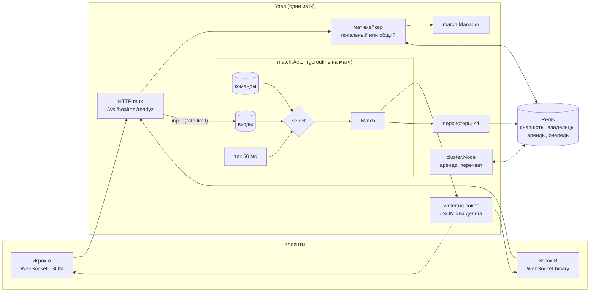
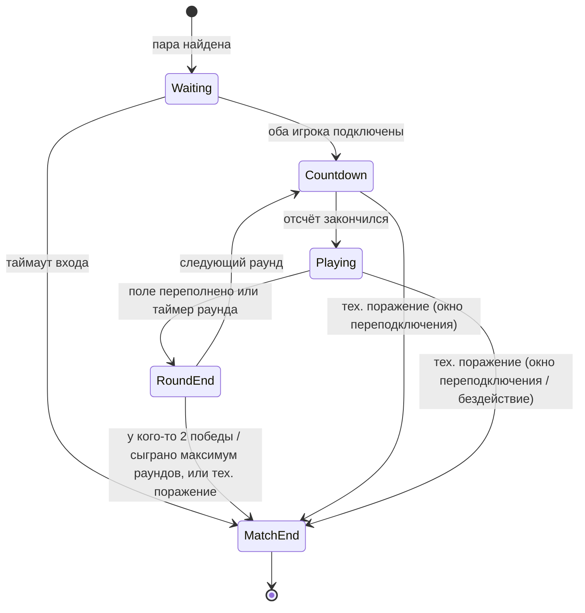

# sabostack-go-server

[](https://github.com/Gegirhasut/sabostack-go-server/actions/workflows/ci.yml)

[English](README.md) | **Русский**

Игровой сервер на Go для real-time PvP 1 на 1 с падающими блоками: авторитетный сервер,
модель акторов, бинарный протокол с дельтами, переподключение без потери матча,
восстановление после падения процесса и кластер из нескольких узлов, который переживает
смерть узла посреди игры.

Это сервер **[SaboStack](https://play.google.com/store/apps/details?id=com.sabostack.app)** —
моей real-time PvP-игры для браузера и Android, опубликованной в Google Play (5K+ скачиваний).

## Коротко в цифрах

Ноутбук, WSL2 8 vCPU, сервер и боты на одной машине (методика в
[LOAD_TESTING.md](docs/LOAD_TESTING.md)):

- **4000 WebSocket-подключений (2000 матчей)** без ошибок: input→ack p95 48–87 мс в
  зависимости от прогона и посторонней нагрузки на хосте. Серверный тик — 50 мс: сервер намеренно копит входы и рассылает состояние раз
  за тик.
- **Бинарный протокол с дельтами:** кадр состояния 14 байт вместо 926, кодирование за
  535 нс без аллокаций вместо 7,6 мкс. Трафик сервер → клиент под нагрузкой меньше **в 18 раз**, CPU сервера ниже на 5–9 % на 1000–2000 парах ([WIRE.md](docs/WIRE.md)).
- **Кластер:** узел убит по SIGKILL под нагрузкой — **188 из 188 игроков вернулись в свои
  матчи** на других узлах (за 7–13 с в зависимости от момента падения), 0 ошибок. При выкатке (SIGTERM) — 206 из 206 за
  3,9 с без потери прогресса ([CLUSTER.md](docs/CLUSTER.md)).
- **~76 КБ памяти и ~0,05 % ядра на игрока** (прирост от 2000 до 4000 подключений в
  [таблице нагрузки](#нагрузочное-тестирование-кратко)). Ограничивает CPU, а не память.
- **133 теста и 2 fuzz-цели, все проходят с `-race`.** 13 тестов воспроизводят найденные
  баги: каждый падает на коде до исправления и проходит после ([HARDENING.md](docs/HARDENING.md)).
  Ещё 41 закрывает дефекты, найденные позже ([HARDENING.md](docs/HARDENING.md#найдено-позже)).
  Тесты хранилища и кластера идут и на miniredis, и на настоящем Redis.
  Нагрузочный бот проверяет инварианты протокола в каждом кадре: в финальных прогонах
  0 нарушений.

## Документация

| Документ | О чём |
|---|---|
| [ARCHITECTURE.md](docs/ARCHITECTURE.md) | Компоненты, машина состояний, модель акторов, таймеры, переподключение, восстановление. |
| [WIRE.md](docs/WIRE.md) | Бинарный протокол: формат кадров, где считаются дельты, как проверена корректность, замеры. |
| [CLUSTER.md](docs/CLUSTER.md) | Несколько узлов: живость, перехват матчей, fencing, общий матчмейкинг, демо с убийством узла. |
| [HARDENING.md](docs/HARDENING.md) | Что было не так под нагрузкой и под атакой, тест на каждый баг, профилирование памяти. |
| [LOAD_TESTING.md](docs/LOAD_TESTING.md) | Методика, ступени до 6000 подключений, ёмкость, soak, шторм, сравнения версий и протоколов. |

## Что демонстрирует проект

| Тема | Где | Как |
|---|---|---|
| Машина состояний | `internal/match/phase.go`, `match.go` | Явная цепочка `Waiting → Countdown → Playing → RoundEnd → MatchEnd` с таблицей переходов. Недопустимый переход — баг: внутри паника, наружу `ErrIllegalTransition`. |
| Одновременные действия | `internal/match/actor.go` | Одна goroutine на матч единолично владеет его состоянием, вокруг игровой логики нет блокировок. Входы обоих игроков применяются в порядке прихода, у каждого места свой лимит, флудер не вытесняет соперника. |
| Идемпотентность | `Match.Input` | Каждый вход несёт `seq`, повторы и устаревшие отбрасываются. Seq переживает перезапуск и перехват матча другим узлом. |
| Бинарный протокол | `internal/wire`, `internal/server/conn.go` | Subprotocol `sabostack.bin.v1`. Дельта считается в writer-goroutine относительно того, что *реально* ушло клиенту, поэтому она согласована со схлопыванием очереди и переподключениями. Fuzzing нашёл и закрыл падение декодера. |
| Таймеры | `Match.Advance`, `internal/clock` | Тик 20 Гц, все таймеры — дедлайны на подменяемых часах, тесты детерминированы. |
| Переподключение | `Match.Attach`, `Match.Advance` | Сессионный токен (хранится только SHA-256), первым сообщением снапшот с пропущенными событиями. Матч никогда не встаёт на паузу: поле отключившегося падает дальше, соперник играет, а у отключившегося 20 с, чтобы вернуться, иначе техническое поражение. |
| Потеря соединения | `Match.Advance`, `internal/server/conn.go` | Полуоткрытое соединение видно по тишине, и замечает её сам матч на своём тике: 8 с без сообщений и pong, и место считается отключённым, окно переподключения пошло, а сокет остаётся открытым на случай, если клиент просто тормозил. Возвращается место после 4 с устойчивой связи (гистерезис: соединение с перебоями не мигает); ход возвращает его сразу. Что делает клиент со своей стороны: [контракт клиента](docs/ARCHITECTURE.md#контракт-клиента--потеря-соединения). |
| Восстановление после падения | `snapshot.go`, `manager.go` | Снапшоты пишут несколько персистеров со схлопыванием и пачками через pipeline, с circuit breaker на случай отказа Redis. После отката к снапшоту номера событий никогда не переиспользуются. |
| Кластер | `internal/cluster`, `internal/store/cluster.go` | Аренда узла одним ключом, перехват матчей мёртвого узла пачками под локом, Lua-fencing владельца, самоограничение при потере Redis, общая очередь матчмейкинга с pub/sub и редиректами. |
| Изоляция сбоев | `Actor.run` | Паника в одном матче прерывает только его. |
| Защита от клиентов | `internal/server` | Token bucket до декодирования, лимиты подключений, Origin, валидация имени, схлопывание кадров `state` для медленных клиентов. |
| Эксплуатация | `cmd/server`, `internal/metrics` | `/healthz`, `/readyz`, draining, admin-порт с `/metrics` и pprof, трафик и причины отключений в метриках, JSON-логи, Docker и compose на 1 и 3 узла. |
| Нагрузка | `cmd/bot`, `cmd/loadreport`, `scripts/` | Бот играет в обоих протоколах, проверяет инварианты, ходит по узлам и переживает их смерть. `loadreport` строит таблицы из сырых JSON (медианы по повторам). |

## Архитектура



### Машина состояний матча



Отключение игрока матч не останавливает: игрок с хорошим соединением не ждёт игрока с плохим.
Пока игрок отключён, его поле падает дальше (фигуры фиксируются, входящий мусор
поднимается, переполнение проигрывает раунд), таймер раунда идёт, соперник играет.
Отключившийся продолжает с того поля, какое стало к его возвращению, а если не вернулся
за окно переподключения (20 с), получает техническое поражение. Если отключены оба и
окна истекли на одном тике, победителя нет (`both_disconnected`), иначе у каждого своё
окно. Таймаут бездействия (30 с без входов) считает только время, пока игрок подключён,
поэтому не срабатывает на того, кого уже считает окно. Единственная остановка — по вине
сервера: после перезапуска или отказа узла обоим игрокам надо найти новый узел, поэтому
восстановленный матч стоит (`paused`), пока не вернутся оба, но не дольше 10 с
(`-resync-wait`). Иначе раунд выигрывал бы тот, чей клиент переподключился первым.
Подробно в [ARCHITECTURE.md](docs/ARCHITECTURE.md#отключения-матч-не-ждёт).

### Правила игры

- Поле 10×20, семь тетромино из 7-bag, в каждом раунде у обоих одна последовательность
  фигур (seed клиентам не уходит).
- Повороты по SRS: его состояния фигур и таблицы смещений (wall kicks), по часовой
  (`rotate`) и против (`rotate_ccw`).
- **Lock delay:** легшая фигура фиксируется через 0,5 с (`-lock-delay`), а не на том шаге
  гравитации, где легла. Так игрок в 100–150 мс от авторитетного сервера успевает
  подвинуть или довернуть её по дну. Сдвиг или поворот лежащей фигуры перезапускает
  задержку, но не больше 15 раз за фигуру (новый нижний ряд возвращает сбросы), так что
  держать фигуру на дне вечно нельзя. `soft_drop` фигуру не фиксирует, `hard_drop`
  фиксирует сразу.
- Очистка 2, 3 или 4 линий отправляет сопернику 1, 2 или 4 мусорных ряда, свои очистки
  сначала гасят входящий мусор. Мусор, вытолкнувший стек за верх поля, — это top-out, как
  и фигура, которой некуда появиться.
- Раунд кончается top-out или по таймеру (побеждает больший счёт). Матч до двух побед.
- Не сделано: hold, бонусы за T-spin и комбо, скрытые ряды над полем. Подробно —
  [ARCHITECTURE.md](docs/ARCHITECTURE.md#правила-игры).

## Протокол

JSON-кадры, тип в поле `type`. Клиент, запросивший WebSocket-subprotocol
`sabostack.bin.v1`, получает `state` и `pong` бинарными дельтами и может слать `input` и
`ping` бинарно. Формат описан в [WIRE.md](docs/WIRE.md).

### Клиент → сервер

| `type` | Поля | Примечание |
|---|---|---|
| `join` | `name` | Первое сообщение: встать в очередь. Имя — 1–24 печатаемых символа. |
| `resume` | `matchId`, `token`, `lastEventSeq` | Первое сообщение: вернуться в матч после обрыва, перезапуска или перехода на другой узел. |
| `input` | `seq`, `action` | `left`, `right`, `rotate` (по часовой), `rotate_ccw`, `soft_drop`, `hard_drop`. `seq` растёт, повторы игнорируются. |
| `ping` | `t` | Возвращается как `pong`. |

Сообщения клиента проходят token bucket (40/с, всплеск 20). Упорный флудер отключается с
ошибкой `rate_limited`.

### Сервер → клиент

| `type` | Поля | Когда |
|---|---|---|
| `queued` | | После `join`. |
| `matched` | `matchId`, `seat`, `token`, `opponent`, `url` | Соперник найден. Если есть `url`, матч идёт на другом узле: подключиться туда и сделать `resume`. |
| `snapshot` | `matchId`, `seat`, `state`, `events[]`, `eventsComplete` | Всегда первое сообщение после подключения к матчу. `eventsComplete=false` — история клиента недействительна (журнал короче или матч откатился к снапшоту после падения узла): доверять `state`, переотправить неподтверждённые входы. Пока `state.paused = true` (восстановленный матч ждёт обоих игроков), входы не слать, а неподтверждённые выбросить: сервер подтверждает и выбрасывает их; слать снова после события `resumed`. |
| `state` | `tick`, `phase`, `round`, `paused`, `remainingMs`, `ack`, `eventSeq`, `players[]` | Не чаще раза за тик и только при изменениях. Неотправленный `state` заменяется новым. `paused` равно `true`, только пока восстановленный после перезапуска или отказа узла матч ждёт игроков (`remainingMs` стоит, входы подтверждаются и выбрасываются); отключение игрока паузы не вызывает. `players[i].connected` равно `false`, пока этот игрок отключён. |
| `event` | `event: {seq, atMs, kind, ...}` | `phase`, `cleared`, `garbage`, `round_over`, `match_over`, `player_left`, `player_back`, `resumed` (восстановленный матч снова идёт). Никогда не теряются и не переупорядочиваются. `paused` больше не отправляется; незнакомые виды событий надо пропускать. |
| `error` | `code`, `message`, `url` | `wrong_server` (переподключиться к `url`), `match_moving` (узел матча упал, его перехватывают — повторить), `match_not_found`, `bad_token`, `rate_limited`, `unavailable`, `bad_name`, `bad_request`, `bad_json`, `timeout`. |
| `pong` | `t` | |

Причины в `match_over`: `rounds`, `draw`, `opponent_disconnected`, `both_disconnected`,
`opponent_idle`, `both_idle`, `disconnected_and_idle`, `opponent_never_joined`,
`internal_error`.

```text
→ {"type":"join","name":"alice"}
← {"type":"queued"}
← {"type":"matched","matchId":"9f2c…","seat":0,"token":"4be1…","opponent":"bob"}
← {"type":"snapshot","matchId":"9f2c…","seat":0,"state":{…,"phase":"waiting"},"events":[],"eventsComplete":true}
← {"type":"event","event":{"seq":1,"kind":"phase","phase":"countdown","round":1,"durationMs":3000}}
← {"type":"event","event":{"seq":2,"kind":"phase","phase":"playing","round":1,"durationMs":90000}}
→ {"type":"input","seq":1,"action":"rotate"}
← {"type":"state","tick":64,"phase":"playing","ack":1,"players":[…]}
   … соединение оборвалось …
→ {"type":"resume","matchId":"9f2c…","token":"4be1…","lastEventSeq":2}
← {"type":"snapshot",…,"state":{…,"phase":"playing"},"events":[{"seq":3,"kind":"player_left","seat":0},{"seq":4,"kind":"garbage","seat":0,"garbage":1},{"seq":5,"kind":"player_back","seat":0}]}
```

## Запуск

Нужен Go 1.25 или новее.

```sh
go run ./cmd/server                        # :8080, хранилище в памяти
go run ./cmd/server -redis localhost:6379  # снапшоты в Redis: после перезапуска матчи продолжаются
go run ./cmd/server -h                     # все флаги

go run ./cmd/bot -pairs 100                # один матч на пару
go run ./cmd/bot -pairs 500 -duration 60s -proto bin   # постоянная нагрузка, бинарный протокол
```

Docker:

```sh
docker compose up --build                                          # один узел и Redis
docker compose -f docker-compose.cluster.yml up --build            # три узла и Redis
docker compose -f docker-compose.cluster.yml run --rm bot          # нагрузка через все узлы
scripts/cluster-failover.sh                                        # убить узел под нагрузкой
scripts/cluster-failover.sh 300 35 SIGTERM                         # выкатка узла под нагрузкой
```

Кластер без Docker: у каждого узла свои `-node-id` и `-public-url`, общий `-redis`:

```sh
go run ./cmd/server -addr :8081 -redis localhost:6379 -node-id game-1 -public-url ws://localhost:8081/ws
go run ./cmd/server -addr :8082 -redis localhost:6379 -node-id game-2 -public-url ws://localhost:8082/ws
```

Основные флаги для продакшена:

| Флаг | По умолчанию | Зачем |
|---|---|---|
| `-admin-addr` | выкл. | `/metrics` и `/debug/pprof` на внутреннем адресе. |
| `-allowed-origins` | любой | Разрешённые Origin браузера. |
| `-max-conns`, `-max-conns-per-ip` | выкл. | Лимиты подключений. |
| `-trusted-proxies` | 0 | Сколько наших прокси стоит перед сервером. IP клиента — столько адресов `X-Forwarded-For` справа. |
| `-input-rate`, `-input-burst` | 40, 20 | Token bucket на сообщения клиента. |
| `-node-id`, `-public-url`, `-lease`, `-shared-queue` | выкл., —, 10 с, вкл. | Кластер ([CLUSTER.md](docs/CLUSTER.md)). |
| `-drain-timeout` | 0 | По SIGTERM перестать матчить и дать матчам доиграть. |
| `-reconnect-grace`, `-idle-timeout`, `-resync-wait` | 20 с, 30 с, 10 с | Правила отключений ([ARCHITECTURE.md](docs/ARCHITECTURE.md#отключения-матч-не-ждёт)). С таймингами, которые их ломают (обрыв замечается только после таймаута бездействия, ping слишком редкий для таймаута тишины, ожидание ресинхронизации не меньше окна), сервер не стартует. |
| `-lock-delay` | 500 мс | Сколько легшая фигура ждёт фиксации (см. правила игры выше). |
| `-ping-interval`, `-silence-timeout`, `-pong-wait` | 2 с, 8 с, 30 с | Heartbeat: клиент, от которого 8 с ничего не слышно, считается отключённым, его сокет закрывается через 30 с. Почему именно так — в [HARDENING.md](docs/HARDENING.md#heartbeat-тишина-8-с-обрыв-30-с). |

### Чеклист продакшена

Значения по умолчанию рассчитаны на локальный запуск и нагрузочные тесты с одного IP. При
каждом небезопасном умолчании сервер пишет предупреждение в лог при старте.

- [ ] `-allowed-origins` — домены веб-клиента. Иначе страница с любого сайта может открыть
      WebSocket от имени игрока.
- [ ] `-max-conns-per-ip` и `-max-conns`. За балансировщиком также `-trusted-proxies` по
      числу прокси, иначе все клиенты будут с IP балансировщика. С `-trusted-proxies` порт
      сервера должен быть доступен **только** прокси (firewall, приватная сеть): клиент,
      подключившийся напрямую, подделает `X-Forwarded-For`.
- [ ] `-admin-addr` на внутреннем интерфейсе и `-public-metrics=false`: `/metrics` и
      `/debug/pprof` не должны быть видны снаружи.
- [ ] `-redis`, а для нескольких узлов ещё `-node-id` и `-public-url` у каждого. Без Redis
      матчи не переживают перезапуск.
- [ ] `-drain-timeout` не меньше длины матча и `terminationGracePeriod` оркестратора
      больше него. Проверки готовности — на `/readyz`.
- [ ] TLS на балансировщике (`wss://`). Сам сервер TLS не терминирует.

## Тесты

```sh
go test -race ./...
go test -run '^$' -fuzz FuzzDecodeState ./internal/wire
```

[CI](.github/workflows/ci.yml) на каждый push:
- `gofmt`, `go mod tidy`, `go vet`, `staticcheck`, `govulncheck`;
- `go test -race -count=2` на минимальной версии Go из `go.mod` и на текущей;
- тесты хранилища, кластера, сервера и перехвата матча на настоящем Redis 7 вместо miniredis
  (`SABO_TEST_REDIS=host:port/15 go test -p 1 ./internal/store ./internal/cluster ./internal/server ./internal/match`;
  каждая проверка очищает указанную базу, поэтому номер базы обязателен, а база 0 запрещена);
- по 30 с fuzzing каждого декодера;
- сборка Docker-образа и запуск с проверкой `/healthz`.

133 теста и 2 fuzz-цели. Конкурентные и кластерные тесты прогонялись многократно
(`-count=20…300`), чтобы исключить нестабильность.

- **Воспроизведение багов (13):** каждый найденный баг покрыт тестом на старом API: на
  коде до исправления он падает с осмысленным сообщением, после проходит
  ([таблица](docs/HARDENING.md#баги-и-их-воспроизведение)).
- **Дефекты, найденные позже (41):** подмена IP через `X-Forwarded-For`, лишнее время до
  idle-форфита после переподключения, self-fencing до истечения аренды, повтор
  несохранённого снапшота, уходящий узел не служит редиректом, `pong` в очереди, отсутствие
  двойного назначения в матчмейкинге, гонка `WaitGroup` при остановке, зомби-матч на
  изолированном узле, утечка заявок ушедших игроков, заявка-призрак в очереди, матч
  объявляется только после записи в хранилище, снапшоты неизвестной версии не удаляются при
  выкатке, токены игроков не попадают в Redis, восстановленный матч ждёт обоих игроков,
  соединение с перебоями не мигает «ушёл / вернулся», тишина не считается бездействием, ход сразу возвращает молчавшего игрока, тайминги проверяются при старте,
  версия снапшота повышена с миграцией, lock delay с ограниченными сбросами, SRS-смещения
  в обе стороны, мусор за верх поля — это top-out ([HARDENING.md](docs/HARDENING.md#найдено-позже)).
- **Бинарный протокол:** 20 000 случайных шагов round-trip, побайтное совпадение полей,
  собранных из дельт, с авторитетным снапшотом через настоящий WebSocket, fuzzing обоих
  декодеров, бенчмарки.
- **Кластер:** перехват, fencing вернувшегося зомби, пачки, `Release`, пара игроков с
  разных узлов, потерянное назначение, отказ Redis дольше аренды, два настоящих сервера,
  где узел-хозяин падает посреди раунда, а матч доигрывается на другом.
- **Игра и протокол:** таблица переходов, полный матч, идемпотентность под `-race`,
  таблицы SRS-смещений (симметрия и порядок проб), lock delay и предел его сбросов,
  таймеры на фейковых часах, восстановление со сдвигом дедлайнов, порядок сообщений при
  `resume`, откат после падения без повтора номеров событий.
- **Отключения (на фейковых часах):** соперник играет и таймер раунда идёт, пока игрок
  отключён; поле отключившегося падает и переполняется; после `resume` виден текущий вид
  поля; истечение окна (в том числе между раундами); оба игрока отключены; бездействие и
  окно не пересекаются; восстановление и перехват через Redis с отключённым игроком;
  восстановленный матч ждёт обоих игроков, и не дольше `-resync-wait`; миграция снапшотов
  версии 1; «молчащее» соединение уходит и возвращается только после устойчивой связи;
  окно и бездействие на одном тике; проверка таймингов при старте.
- **Транспорт и эксплуатация:** флуд, схлопывание очереди, Origin, лимит на IP, draining,
  редирект к владельцу, admin-порт, битые кадры, обнаружение тишины (на фейковых часах и
  по pong через настоящие сокеты).

## Нагрузочное тестирование (кратко)

Методика и сырые данные — в [docs/LOAD_TESTING.md](docs/LOAD_TESTING.md). Сервер и боты на
одном ноутбуке в WSL2 (8 vCPU, i9-10885H), loopback, параллельно шла посторонняя нагрузка.
Каждый бот шлёт 10 входов в секунду и после матча снова встаёт в очередь.

JSON-протокол, медианы по прогонам (сырые данные в `docs/loadtest/hardening/`):

| Пар | Подключений | RSS сервера | CPU сервера | Input→ack p50 / p95 / p99 | Ошибок / обрывов |
|---:|---:|---:|---:|---:|---:|
| 500 | 1000 | 106 МБ | 92 % ядра | 25,6 / 48,4 / 50,4 мс | 0 / 0 |
| 1000 | 2000 | 187 МБ | 150 % ядра | 25,6 / 48,4 / 50,6 мс | 0 / 0 |
| 2000 | 4000 | 339 МБ | 255 % ядра | 28,2 / 61,7 / 132 мс | 0 / 0 |
| 3000 | 6000 | 479 МБ | 330 % ядра | 32,1 / 96,0 / 198 мс | 0 / 0 |

Эти прогоны шли со старым heartbeat (ping раз в 20 с). Ping раз в 2 с, как сейчас, замерен
против него на том же стенде: на 1000 парах в пределах шума, на 2000 парах (4000
подключений) около +4 % CPU сервера, память та же, ошибок нет
([HARDENING.md](docs/HARDENING.md#стоимость-пингов-раз-в-2-с)). Lock delay и SRS-смещения
появились ещё позже и отдельно не замерялись: на поле за шаг гравитации они добавляют одну
проверку столкновения четырёх клеток.

Бинарный протокол на тех же ступенях (медианы, [WIRE.md](docs/WIRE.md#под-нагрузкой)):

| Пар | Трафик на клиента: JSON → дельты | CPU сервера: JSON → дельты | p95: JSON → дельты |
|---:|---:|---:|---:|
| 1000 | 3,65 → **0,20 КБ/с** | 171 → 162 % | 49 → 49 мс |
| 2000 | 3,72 → **0,20 КБ/с** | 269 → 247 % | 161 → 84 мс |
| 3000 | 3,65 → **0,20 КБ/с** | 312 → 314 % | 154 → 135 мс |

- Задержка input→ack — это в основном намеренное ожидание тика: в среднем полтика, не
  больше одного тика.
- На 3000 парах общая машина насыщается: сервер и боты делят 8 vCPU, и хвост задержки
  определяет конкуренция за CPU, а не сервер.
- Soak 1000 пар × 5 мин: RSS и goroutines стабильны. Шторм переподключений (20 %
  клиентов): 100 % вернулись в свои матчи. Кластер из 3 узлов с Redis под нагрузкой и
  с убийством узла — в [CLUSTER.md](docs/CLUSTER.md#демо-узел-убит-под-нагрузкой).

## Решения и ограничения

- **Один матч — одна goroutine.** Игровая логика — синхронный код, который легко
  тестировать. Цикл матча никогда не ждёт I/O: отправка клиенту, Redis и сеть идут через
  очереди.
- **Бинарными сделаны только горячие сообщения** (`state`, `input`): это почти весь
  трафик. Редкие сообщения остались JSON ради читаемости.
- **Матч не ждёт отключившегося.** В PvP игрок с хорошим соединением не должен
  расплачиваться за плохое соединение соперника. Платит тот, кто отключился: его поле
  идёт без него, пока он не вернётся (обычное переподключение занимает несколько секунд).
- **Инфраструктура включается по запросу.** Из коробки сервер — один процесс с хранилищем в
  памяти, клиенты говорят на JSON. Redis (`-redis`), кластер (`-node-id`) и бинарный
  протокол (подпротокол WebSocket, который запрашивает клиент) включаются, только если их
  попросить. Игре с сотнями игроков хватает одного узла; остальное нужно, чтобы матч
  пережил падение узла или выкатку посреди игры, и ничего не стоит, пока выключено.
- **Безопасность важнее доступности при разделе:** узел, потерявший Redis дольше аренды,
  останавливает свои матчи и поднимает их снова, когда Redis вернулся.
- **Ограничения:**
  - Кластеру нужен один Redis (или Sentinel), а не Redis Cluster: Lua-скрипты работают с
    ключами разных слотов.
  - После жёсткого падения узла матч откатывается к последнему снапшоту (до 1 с прогресса).
  - Нет аутентификации, рейтинга и античита сверх авторитетного сервера и лимитов.
  - Нет hold, бонусов за T-spin и комбо, скрытых рядов над полем.

## Структура

```text
cmd/server        сервер: флаги, Redis/память, кластер, draining, штатная остановка
cmd/bot           нагрузочный бот: JSON и binary, проверка инвариантов, работа с кластером
cmd/loadreport    таблицы и графики docs/LOAD_TESTING.md из сырых JSON
internal/clock    интерфейс Clock, реальные и фейковые часы
internal/game     поле, фигуры, 7-bag, линии, мусор (чистая детерминированная логика)
internal/match    машина состояний, актор, Manager, персистеры, снапшоты
internal/lobby    локальная FIFO-очередь матчмейкинга
internal/cluster  аренда узла, перехват матчей, общий матчмейкинг через Redis
internal/store    Store; память, Redis, режим узлов с fencing, каталогом и арендами
internal/wire     бинарный протокол: кодек дельт, fuzz-тесты
internal/server   WebSocket, JSON и binary writer, rate limit, лимиты, health/ready/admin
internal/protocol типы JSON-сообщений
internal/metrics  коллекторы Prometheus
docs/             документация и сырые результаты нагрузки (docs/loadtest/)
scripts/          ступень нагрузки, сравнения версий и вариантов, демо отказа узла
```

## Лицензия

MIT
