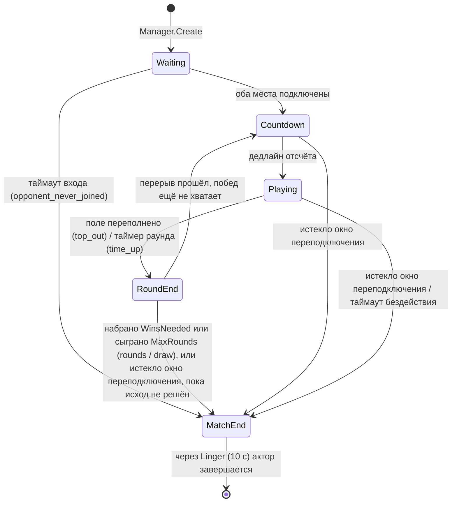

# Архитектура

Здесь описано то, что код этого репозитория делает сейчас. То, что ещё не сделано,
явно помечено в разделе «Масштабирование».

## Компоненты


| Пакет | Ответственность |
|---|---|
| `internal/server` | Принимает upgrade на `/ws` (лимиты подключений всего и на IP, проверка Origin). Первый кадр обязан быть `join` или `resume`, дальше `input` пересылаются актору матча. На каждый сокет две goroutine: reader и writer. Reader пропускает сообщения через token bucket и отключает упорного флудера. Пишет в сокет только writer. Его очередь исходящих схлопывает кадры `state`: в ней лежит только последний неотправленный. События, снапшоты и ошибки не теряются никогда, и 128 таких сообщений в очереди означают медленного клиента, которого отключают (он может сделать `resume`). Goroutine подключения следит за тишиной клиента ([контракт клиента](#контракт-клиента--потеря-соединения)). Здесь же `/healthz`, `/readyz`, draining и admin-обработчик с `/metrics` и pprof. |
| `internal/lobby` | FIFO-очередь на связном списке под mutex: вход и выход за O(1). Второй вошедший игрок получает в пару первого, через `Manager.Create` создаётся матч, и оба получают `Assignment`: id матча, место и сессионный токен. Заявки игроков, чьё подключение уже закрыто, пропускаются. |
| `internal/match` (`Manager`) | Реестр запущенных акторов (map под mutex). Создаёт матчи, восстанавливает их из хранилища при старте и останавливает все акторы разом (каждый пишет финальный снапшот), не дольше контекста остановки. Держит несколько персистеров (по умолчанию 4). Матч по хэшу id всегда попадает в один и тот же, поэтому записи одного матча идут строго по порядку. Ожидающая запись матча заменяется более свежей, пачки до 64 записей уходят в хранилище за один запрос, а circuit breaker отключает запись, пока хранилище недоступно. |
| `internal/match` (`Actor`) | Одна goroutine на матч. Единолично владеет своим `Match` и крутит `select` по источникам: канал команд (замыкания от других goroutine), очередь входов, тикер часов, сигналы остановки и вытеснения. Паника внутри перехватывается: прерывается только этот матч. |
| `internal/match` (`Match`) | Обычное синхронное состояние: фаза, раунд, места, дедлайны и ограниченный журнал событий. Время приходит только аргументом `now`. Сообщения `snapshot`, `state` и `event` отдаются через интерфейс `Sink`. |
| `internal/game` | Детерминированная симуляция одного поля: 7-bag, движение, очистка линий, мусорные ряды. Без времени и I/O, полностью сериализуется в JSON. |
| `internal/store` | Интерфейс `Store` (`Save`, `Delete`, `LoadAll`) и необязательные `Batcher` (пакетная запись) и `Directory` (кто владеет матчем). `Memory` — map под mutex. `Redis` хранит ключ `<prefix>match:<id>` с TTL (по умолчанию 1 ч). В режиме одного узла id лежат в множестве `<prefix>matches`. В режиме узлов (`ForNode`) у матча есть ключ владельца, запись и удаление идут Lua-скриптами с проверкой владельца, а у каждого узла своё множество id. |
| `internal/wire` | Бинарный протокол: кодек дельт состояния и кадров клиента. Дельту считает writer-goroutine подключения относительно того, что реально ушло клиенту ([WIRE.md](WIRE.md)). |
| `internal/cluster` | Аренда узла и перехват матчей мёртвых узлов (`Node`), общий матчмейкинг через Redis (`Matchmaker`) ([CLUSTER.md](CLUSTER.md)). |
| `internal/protocol` | Структуры JSON-сообщений, общие для сервера, бота и тестов. |
| `internal/metrics` | Gauge подключений, активных и «живых» матчей, ожидающих записей. Гистограммы длительности тика и размера снапшота. Счётчики входов по результату, завершённых матчей по причине, записей снапшотов по результату, паник акторов, отказов в подключении и отключений по причине. |
| `internal/clock` | Интерфейс `Clock` (`Now`, `NewTicker`), реальные часы и фейковые часы для тестов. |

## Жизненный цикл матча



- Все допустимые переходы перечислены в одной таблице (`transitions` в `phase.go`).
  `Match.Transition` на любой другой переход возвращает `*ErrIllegalTransition`. Внутренний
  хелпер в этом случае паникует: недопустимый переход изнутри — это баг.
- **Отключение игрока матч не останавливает**; правила ниже, в
  «[Отключения: матч не ждёт](#отключения-матч-не-ждёт)». Стоит матч только после
  перезапуска или перехвата узлом, пока не вернутся оба игрока (не дольше `ResyncWait`).
- После `MatchEnd` снапшот удаляется из хранилища. Ещё `Linger` актор отвечает на
  `resume` финальным снапшотом, затем закрывает сокеты и завершается.

### Отключения: матч не ждёт

Правило для PvP: игрок с хорошим соединением никогда не ждёт игрока с плохим. Поэтому
отключение игрока матч не останавливает ни в одной фазе. Единственная остановка — по вине
сервера, после восстановления (ниже, «Ресинхронизация после восстановления»).

- **Пока игрок отключён,** его место помечено `Connected=false`: соперник видит это в
  `players[i].connected` и получает событие `player_left`. Матч при этом идёт как обычно.
  Гравитация опускает фигуру отключённого, фигуры фиксируются, входящий мусор поднимается,
  переполнение проигрывает раунд. Отсчёт, таймер раунда и перерыв между раундами идут по
  своим дедлайнам. Соперник играет, его входы применяются.
- **Окно переподключения** `ReconnectGrace` (20 с, флаг `-reconnect-grace`) считается от
  `Seat.LeftAt`. Вернувшийся через `resume` получает снапшот текущего состояния, то есть
  своё поле таким, каким оно стало, и сразу играет дальше. Не вернувшийся вовремя
  проигрывает матч (`opponent_disconnected`) в `Countdown`, `Playing` или `RoundEnd`. Одно
  исключение: если в `RoundEnd` исход уже решён по раундам, результат остаётся (`rounds`).
  Отключиться в перерыве после победного раунда не значит проиграть.
- **Отключены оба.** Матч идёт и тогда: поля падают, таймер раунда идёт. У каждого своё
  окно, и кто ушёл первым, первым и проигрывает, даже если второй тоже ещё не вернулся.
  Победа в этом случае достаётся игроку, который в этот момент тоже не в сети. Это
  осознанно: он ушёл позже и его окно ещё не истекло, то есть правил он не нарушил, а
  сервер не отличит сбой сети от ухода. В `match_over` причина `opponent_disconnected`, а
  `players[i].connected` в последнем `state` показывает, что победитель тоже отсутствовал.
  Начислять ли за такую победу рейтинг, решает сервис, который его ведёт: всё нужное для
  этого в результате есть. Если окна истекают на одном тике, победителя нет
  (`both_disconnected`).
- **Бездействие.** `IdleTimeout` (30 с без входов в `Playing`) считает только время, пока
  игрок подключён. Для отключённого действует только окно, так что для одного игрока два
  таймера не срабатывают никогда: место либо подключено (идёт счёт бездействия), либо нет
  (идёт окно). При возвращении `LastInput` сдвигается вперёд ровно на время отсутствия.
  Отсутствие не считается бездействием, но и не обнуляет счёт: иначе переподключение раз в
  20 с спасало бы от поражения за бездействие. Замена живого сокета новым `LastInput` не
  трогает вовсе. Счёт бездействия стоит с `Seat.IdleStop`: с ухода игрока или с начала
  ресинхронизации. Если на одном тике выбывают оба игрока, победителя нет: при двух
  истёкших окнах причина `both_disconnected`, при двух бездействиях `both_idle`, а если
  у одного истекло окно, а другой бездействовал, `disconnected_and_idle`.
- **Молчащее соединение.** Полуоткрытый TCP (телефон сменил сеть, закрытие так и не
  пришло) замечает сам матч, на своём тике: через `SilenceTimeout` (8 с) без сообщений и
  pong место помечается отключённым, и окно считается с этого момента. Возвращается место
  не по первому же pong, а когда клиента слышно ровно `SilenceTimeout/2` (4 с) без
  перерыва такой же длины. Это гистерезис: соединение, которое то оживает, то замирает,
  остаётся отключённым, а не мигает `player_left`/`player_back` у соперника и не забивает
  журнал событий. Подробно в
  «[Контракт клиента / потеря соединения](#контракт-клиента--потеря-соединения)».
- **Ресинхронизация после восстановления.** После перезапуска или перехвата матча другим
  узлом оба игрока отключены, и их клиентам нужно несколько секунд, чтобы найти новый узел.
  Если матч сразу шёл бы дальше, раунд выигрывал бы тот, чей клиент переподключился
  первым: виноват сервер, а проигрывал бы игрок. Поэтому восстановленный матч в
  `Countdown`, `Playing` и `RoundEnd` стоит (`state.paused = true`), пока не вернутся оба,
  но не дольше `ResyncWait` (10 с, `-resync-wait`). Пока он стоит, поля не падают,
  `remainingMs` не убывает, входы не применяются, счёт бездействия стоит. Когда матч
  трогается, все его часы сдвигаются на время стоянки, а клиенты получают событие
  `resumed`. Окно переподключения отсутствующего идёт с момента восстановления и стоянкой
  не продлевается: не вернувшийся за 10 с играет оставшиеся 10 с окна на падающем поле.
  `ResyncWait` обязан быть меньше `ReconnectGrace`, иначе сервер не стартует.

## Модель акторов и одновременные действия

**Почему актор.** Два игрока действуют одновременно, срабатывают таймеры, сокеты
подключаются и отваливаются, и всё это над одним состоянием матча. Если у каждого матча
одна goroutine, которая единолично владеет этим состоянием, то:

- в игровой логике нет блокировок;
- не бывает частично применённых обновлений;
- `Match` остаётся обычным синхронным кодом, который тестируется без goroutine.

Другие goroutine никогда не трогают `Match` напрямую:

- `Attach` и `Detach` — замыкания в канале команд. Они блокируются, пока актор не примет
  команду, а `Attach` дополнительно ждёт результата (место или ошибку).
- `Input` не блокируется. Вход кладётся в очередь входов матча, а актор будится через
  канал на одно место. Очередь общая для обоих игроков и хранит порядок прихода, но лимит
  в 128 входов считается отдельно для каждого места. Если лимит игрока исчерпан, его вход
  отбрасывается (`overflow`), а входы соперника продолжают приниматься. Клиент не увидит
  ack и может повторить вход с тем же `seq`.
- Очередь входов — срез под mutex, а не буферизованный канал. Канал аллоцирует все слоты
  сразу, и на тысячах матчей это была самая большая статья heap. Срез растёт только на
  время всплеска.

**Порядок.** Входы применяются в том порядке, в котором пришли, без приоритета какого-либо
места. Перед каждой командой актор дочищает очередь входов, поэтому вход, отправленный до
`Detach`, применится до него. Влияние на соперника (мусор, конец раунда) вычисляется в
той же goroutine сразу после входа, который его вызвал. Смена фазы, вызванная входом,
сразу логируется и снимается снапшотом.

**Дедупликация.** Для каждого места хранится `LastSeq` — наибольший уже использованный
`seq`. Для входа с номером `seq`:

1. Если `seq <= LastSeq`, вход отбрасывается как `duplicate`. Это повторы, переставленные
   и устаревшие пакеты.
2. Если действие неизвестно, вход отбрасывается как `invalid`, `seq` не расходуется.
3. Иначе `seq` расходуется (`LastSeq = seq`), даже если фаза не `Playing`
   (`not_playing`). Поэтому вход, отправленный во время отсчёта, никогда не применится
   позже, в другом раунде.
4. Действие применяется к полю.

Пропуски в `seq` разрешены. `LastSeq` входит в снапшот, поэтому дедупликация переживает
перезапуск. В каждом сообщении `state` есть `ack = LastSeq` для получателя.

**Пакетная рассылка.** Вход только помечает матч как изменённый. На каждом тике актор
шлёт каждому игроку не больше одного `state`, и только если что-то изменилось. События
(`phase`, `cleared`, `garbage`, `round_over` и т. д.) отправляются сразу, в момент
возникновения.

## Таймеры и подменяемые часы

У каждого матча один тикер (`TickInterval`, по умолчанию 50 мс). Все таймеры — это
дедлайны, которые на каждом тике сравниваются с `clock.Now()`. Отдельных `time.Timer`
нет:

| Таймер | Поле / правило |
|---|---|
| Таймаут входа | `PhaseEnds` в `Waiting` |
| Отсчёт | `PhaseEnds` в `Countdown` |
| Таймер раунда | `PhaseEnds` в `Playing`. По истечении побеждает больший счёт, при равенстве ничья |
| Пауза после раунда | `PhaseEnds` в `RoundEnd` |
| Гравитация | `NextGravity`, растёт на `Gravity`. Опоздавший тик догоняет не больше 10 шагов |
| Таймаут бездействия | `now - Seat.LastInput >= IdleTimeout` в `Playing`, только для подключённого места. При возвращении `LastInput` сдвигается на время отсутствия |
| Окно переподключения | `now - Seat.LeftAt >= ReconnectGrace` для отключённого места в `Countdown`, `Playing` и `RoundEnd` (пока исход не решён) |
| Тишина соединения | `now - lastHeard >= SilenceTimeout` (8 с). Проверяет goroutine подключения раз в `SilenceTimeout/4` по часам матча |

`match.Manager` получает `clock.Clock`. В продакшене это `clock.Real`, в тестах
`clock.Fake`. `Advance(d)` у фейковых часов выдаёт все наступившие тики по порядку и
ждёт, пока goroutine актора примет каждый. Следующий вызов `Actor.Inspect` встаёт в
очередь за этим тиком, поэтому проверки видят детерминированное состояние. Юнит-тесты
`Match` обходятся вовсе без goroutine: они вызывают `Advance(now)` с явным временем.

## Переподключение и восстановление после падения

**Сессионные токены.** `Match` хранит только SHA-256 токена каждого места и сравнивает
его за постоянное время. В кластере токен создаёт узел, к которому подключён игрок, и он
не покидает этот узел: в заявке, записи назначения и pub/sub-сообщении есть только хэш.
Поэтому чтения Redis недостаточно, чтобы занять чужое место. Новое подключение к месту заменяет старое, а запоздавший
`Detach` старого сокета игнорируется.

**Журнал событий.** У каждого события есть сквозной для матча `seq`, и оно попадает в
ограниченный журнал (по умолчанию 256 событий). Клиент при `resume` присылает
`lastEventSeq` и получает все события после него. `eventsComplete = false` значит, что
журнал уже не доходит до этого номера. В любом случае авторитетно поле `state` снапшота.

**Снапшоты.**

- Актор сериализует `Match` в JSON с номером версии и временем `savedAt`: поля, состояние
  RNG, дедлайны, `LastSeq`, время ухода отключённых игроков и последние 32 события журнала.
- Это происходит при создании матча, при каждой смене фазы, раз в `SnapshotEvery` (1 с),
  если состояние изменилось (и принудительно раз в 10 интервалов), и финально при
  остановке.
- Цикл матча не ждёт записи. Пока запись матча ждёт персистера, более свежий снапшот её
  заменяет, поэтому очередь держит не больше одной записи на матч и не выбрасывает новые.
  Удаление законченного матча тоже асинхронное, а страховкой служит TTL. Ждут только
  финальные снапшоты при остановке, и не дольше двух таймаутов хранилища.
- При жёстком падении теряется прогресс не больше чем примерно за один интервал
  снапшотов. Клиенты увидят меньший `ack` и поле в состоянии на момент снапшота.
- Очередь матчмейкинга не сохраняется: игрокам в очереди нужно заново отправить `join`.

**Восстановление при старте.**

- `Manager.Restore` загружает все снапшоты и проверяет их версию. Битые снапшоты и
  снапшоты уже в `MatchEnd` отбрасываются.
- Все ненулевые дедлайны сдвигаются на `now - savedAt`, чтобы простой сервера не съедал
  время раунда или отсчёта.
- Все места помечаются отключёнными: подключённые на момент снапшота получают
  `LeftAt = now`. У места, отключённого ещё до падения, `LeftAt` сдвигается вместе с
  дедлайнами, и оставшаяся часть окна сохраняется. Затем матч стоит, пока не вернутся оба
  игрока, но не дольше `ResyncWait` ([ресинхронизация](#отключения-матч-не-ждёт)).
- Снапшот, снятый во время такой стоянки, хранит `resyncFrom`: часы стояли с этого
  момента, поэтому при следующем восстановлении дедлайны сдвигаются от него, и раунд
  сохраняет оставшееся время.
- **Версия формата 2.** В версии 1 одни и те же байты значили «матч на паузе» для сборок с
  паузой при отключении и «матч идёт» для следующих. В смешанном кластере один матч вёл
  бы себя по-разному в зависимости от узла, поэтому версия повышена. Миграция 1 → 2
  переносит `pausedAt` в `resyncFrom` (раунд сохраняет оставшееся время), выбрасывает
  бюджет пауз `awayUsed` и заводит `idleStop` из `leftAt`. Узел версии 1 снапшоты версии
  2 не трогает: не восстанавливает, не перехватывает и не удаляет (`SnapshotSupported`).

```mermaid
sequenceDiagram
    participant C as Клиент (место 0)
    participant S as server (ws-обработчик)
    participant A as match.Actor
    participant P as персистер
    participant R as Store (Redis)

    Note over A,R: обычная игра
    A->>P: снапшот раз в 1 с и при смене фазы (без ожидания)
    P->>R: SET match:<id> + SADD matches

    Note over C,S: сокет оборвался
    S->>A: Detach(место 0)
    A-->>A: player_left; матч идёт, окно переподключения пошло

    Note over C,R: штатная остановка (SIGTERM) или перезапуск
    A->>P: финальный снапшот (ждёт записи)
    P->>R: SET match:<id>
    A--xC: close 1001 "server shutting down"

    Note over S,R: старт нового процесса
    S->>R: LoadAll
    R-->>S: снапшоты
    S-->>A: Restore: сдвиг дедлайнов на простой, места отключены, матч стоит (paused)

    C->>S: resume {matchId, token, lastEventSeq}
    S->>A: Attach(token, sink, lastEventSeq)
    A-->>A: проверка хэша токена, player_back
    A->>C: snapshot {state (paused), события после lastEventSeq, eventsComplete}
    Note over A: оба вернулись или прошло ResyncWait
    A->>C: event resumed, дальше state при изменениях (не чаще раза за тик) и события
```

## Контракт клиента / потеря соединения

Что сервер ждёт от клиента и что ему гарантирует. Числа — значения по умолчанию из кода:
`match.DefaultConfig`, `server.DefaultConfig`.

**Сервер.**

- Во время `playing` клиент получает `state` не чаще раза за тик (`TickInterval`, 50 мс) и
  только при изменениях. Фигура падает каждые `Gravity` (500 мс), поэтому идущий раунд
  шлёт `state` минимум дважды в секунду. В `countdown` и `round_end` (по 3 с) изменений
  может не быть совсем, так что признаком «сервер жив» во всех фазах служит `pong`, а не
  `state`.
- На `ping` сервер сразу отвечает `pong` с тем же `t`: JSON `{"type":"ping","t":…}` или
  бинарный кадр `0x11` с ответом `0x02`. Отвечает в любой фазе, и в очереди тоже.
- Сам сервер шлёт WebSocket-ping каждые `PingInterval` (2 с, `-ping-interval`). Браузер и
  библиотеки WebSocket отвечают на него сами, из JS этот обмен не виден.
- Клиент, от которого `SilenceTimeout` (8 с, `-silence-timeout`) ничего не приходит (ни
  сообщения, ни pong), считается отключённым. Место помечается `Connected=false`,
  сопернику уходит `player_left`, начинается окно переподключения (`ReconnectGrace`,
  20 с). Сокет при этом не закрывается. Если клиент просто тормозил, место возвращается
  (`player_back`), когда его слышно 4 с подряд без перерыва в 4 с: живой клиент отвечает
  на ping каждые 2 с. Снапшот ему не нужен, он ничего не пропустил. Сокет закрывается
  только после `PongWait` (30 с, `-pong-wait`) тишины, а окно и тогда считается от начала
  тишины.
- Проверяет тишину актор матча на своём тике, по времени последнего сообщения или pong,
  которое записывает горутина чтения. Поэтому решение «ушёл / вернулся» упорядочено с
  входами того же матча, а горутина чтения ничего не ждёт.
- Соотношения таймингов проверяются при старте, и с нарушенными сервер не запускается:
  обрыв должен замечаться раньше `IdleTimeout` (иначе пропавший проигрывает по
  бездействию, не получив окна), ping должен идти чаще половины `SilenceTimeout`,
  `ResyncWait` должен быть меньше `ReconnectGrace`.

**Клиент.**

- **Heartbeat.** Шлёт `ping` раз в 1 с. Ответ на него — признак живого соединения в фазах
  без `state`. Rate limit (40 сообщений в секунду, всплеск 20) это не задевает.
- **Обнаружение обрыва.** Если от сервера 3 с ничего не пришло (ни `state`, ни `event`, ни
  `pong`, то есть пропали три ответа подряд), клиент показывает оверлей «Переподключение,
  подождите».
- **Ввод при обрыве блокируется.** Пока виден оверлей, клиент не принимает ходы и не копит
  их локально, чтобы потом отправить пачкой. Входы, отправленные до обрыва и не
  подтверждённые `ack`, можно отправить повторно с теми же `seq`: повторы сервер отбросит.
- **Автоматический `resume`.** Клиент закрывает старый сокет и повторяет `resume`
  (`matchId`, `token`, `lastEventSeq`) с задержкой между попытками, пока не получит `snapshot`
  или окончательную ошибку (`bad_token`, `match_not_found`). На `wrong_server` он
  переподключается к `url`, на `match_moving` повторяет. Новое подключение вытесняет
  старое, поэтому повтор безопасен. На всё есть окно: 20 с с момента, когда сервер
  пометил игрока отключённым.
- **После `resume` рисуется снапшот, а не своя картинка.** Сервер авторитетен, так что
  рассинхронизации не бывает: игрок видит то, что на самом деле случилось с его полем, пока
  его не было. Фигура упала дальше, мог прийти мусор, мог закончиться раунд.
  `eventsComplete=false` значит, что история событий клиента недействительна (журнал
  короче или матч откатился к снапшоту после падения узла): верить только `state` и
  переотправить неподтверждённые входы.
- **Соперник играет дальше.** Протокол несёт ему индикатор: события `player_left` и
  `player_back` с номером места и `players[i].connected` в каждом `state`. Клиент
  показывает «Соперник переподключается». Длительность окна в протоколе не передаётся,
  поэтому обратный отсчёт от `atMs` события `player_left` клиент может вести только по
  известному ему значению (20 с по умолчанию). Таймер раунда не останавливается
  (`remainingMs` убывает), поле отключившегося продолжает падать у соперника на экране.
- **`state.paused`** бывает `true` только во время ресинхронизации после перезапуска или
  перехвата: матч стоит, `remainingMs` не убывает, входы не применяются (подтверждаются
  `ack`, но не действуют, как в `countdown`). Клиент видит это в снапшоте, который
  получает на `resume`, и показывает «Ждём соперника». Конец стоянки — событие `resumed`.
  Отключение соперника паузы не вызывает никогда. Событие `paused` сервер не шлёт, а
  незнакомые виды событий клиент пропускает.
- **Старые клиенты.** Для сборок клиента под паузу при отключении изменился смысл
  `player_left`: раньше матч в этот момент вставал, теперь идёт дальше. Клиент, который на
  `player_left` блокирует ввод своего игрока, заставит хорошего игрока проиграть. Версии
  протокола в `join`/`resume` нет, поэтому старый клиент сервер отличить не может, и
  перед выкаткой это поведение надо проверить в каждом выпущенном клиенте. Правило для
  клиента: ввод своего игрока блокируется только при потере *своего* соединения (выше), а
  `player_left` соперника — только индикатор. Если выпущенные клиенты поступают иначе,
  нужно поле версии в `join`/`resume` и отказ слишком старым клиентам.

## Масштабирование

### Один процесс

- Матч живёт ровно в одном процессе. Очередь лобби, реестр акторов и состояние идущих
  матчей хранятся в его памяти.
- Хранилище содержит снапшоты только для восстановления. Во время игры к нему обращаются
  только персистеры, цикл матча — никогда.
- Процесс масштабируется по ядрам, потому что каждый матч — независимая goroutine.
  Измерения в [LOAD_TESTING.md](LOAD_TESTING.md).

### Несколько узлов на одном Redis (реализовано)

Включается флагами `-node-id` и `-public-url`:

- **Владение и fencing.** У каждого матча есть ключ `<prefix>owner:<id>` со значением
  `<node> <publicURL>`. Запись и удаление снапшота — Lua-скрипты, которые атомарно
  проверяют владельца и отказывают, если матч принадлежит другому узлу (`ErrNotOwner`).
  Узел, получивший отказ, перестаёт вести матч и закрывает его клиентов. Два узла не могут
  одновременно вести и сохранять один матч.
- **Восстановление по узлам.** У каждого узла своё множество id, и при старте он
  поднимает только свои матчи. Узлу нужен стабильный id (например имя pod в StatefulSet).
- **Маршрутизация.** `resume`, попавший на узел, у которого нет матча, получает
  `wrong_server` с `url` владельца из каталога, а если владелец мёртв и матч
  перехватывается — `match_moving` («повторите»).
- **Откат после падения.** Матч, поднятый из периодического (не финального) снапшота,
  сдвигает счётчики событий и тиков вперёд, чтобы номера, которые клиент видел у
  потерянных событий, не повторились. Первый `resume` каждого игрока получает
  `eventsComplete=false`.

### Общий матчмейкинг и перехват матчей (реализовано)

- **Общая очередь.** Игроки с любых узлов попадают в одну очередь в Redis. Узел, снявший
  пару, ведёт матч, а игрок другого узла получает `matched.url` и переходит туда.
- **Перехват.** Узел продлевает аренду одним ключом. Матчи узла с истёкшей арендой живые
  узлы забирают пачками и поднимают из снапшотов. Вернувшийся «зомби» не может записать
  чужой матч, а узел, потерявший Redis, сам останавливает свои матчи и поднимает их снова,
  когда Redis вернулся.

Подробно, с гарантиями, ограничениями и демо, где узел убивают под нагрузкой, — в
[CLUSTER.md](CLUSTER.md).
- **Частота снапшотов против потерь.** При переезде на другой узел матч теряет прогресс
  до одного интервала снапшотов. Чтобы потерь не было, понадобился бы журнал входов
  (например стрим Redis), который проигрывается поверх последнего снапшота.
