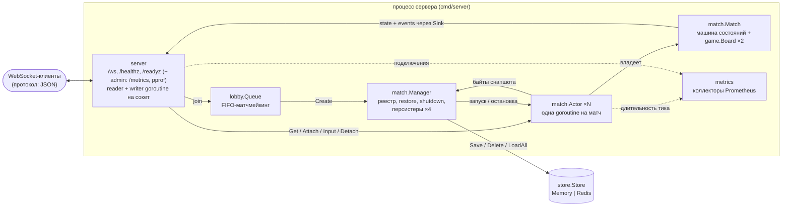
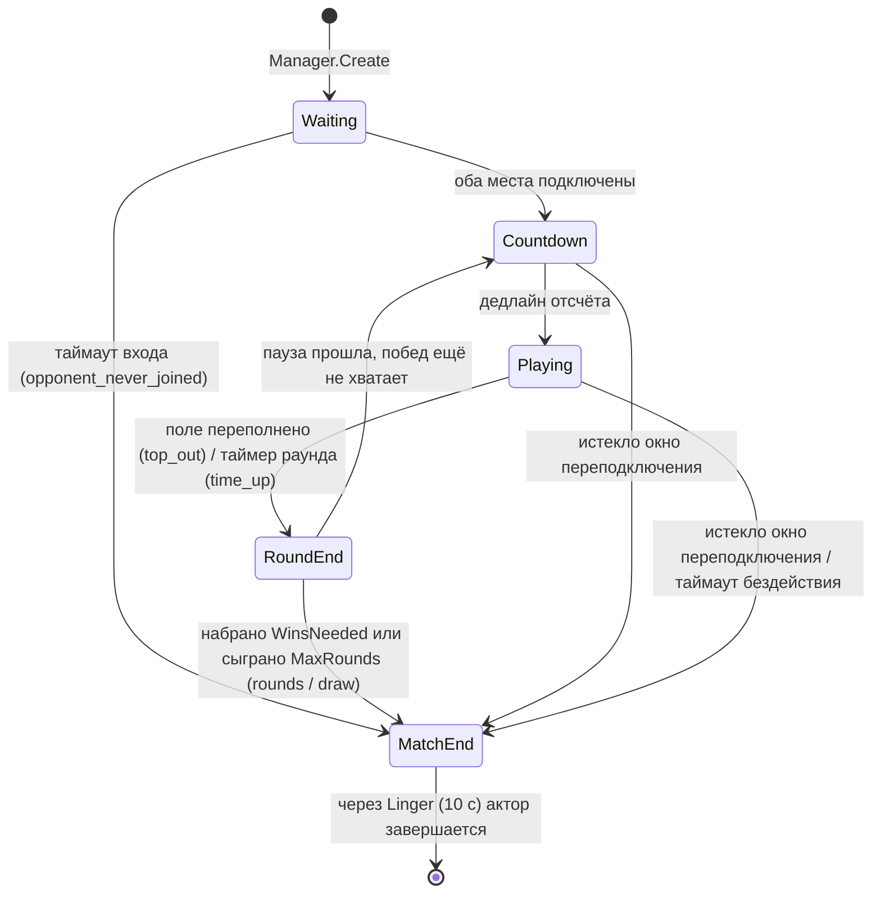
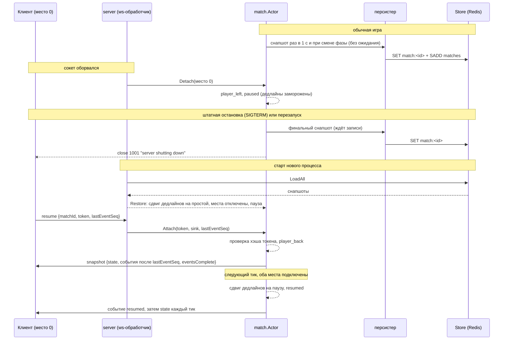

# Архитектура

Здесь описано то, что код этого репозитория делает сейчас. То, что ещё не сделано,
явно помечено в разделе «Масштабирование».

## Компоненты

| Пакет | Ответственность |
|---|---|
| `internal/server` | Принимает upgrade на `/ws` (лимиты подключений всего и на IP, проверка Origin). Первый кадр обязан быть `join` или `resume`, дальше `input` пересылаются актору матча. На каждый сокет две goroutine: reader и writer. Reader пропускает сообщения через token bucket и отключает упорного флудера. Пишет в сокет только writer. Его очередь исходящих схлопывает кадры `state`: в ней лежит только последний неотправленный. События, снапшоты и ошибки не теряются никогда, и 128 таких сообщений в очереди означают медленного клиента, которого отключают (он может сделать `resume`). Здесь же `/healthz`, `/readyz`, draining и admin-обработчик с `/metrics` и pprof. |
| `internal/lobby` | FIFO-очередь на связном списке под mutex: вход и выход за O(1). Второй вошедший игрок получает в пару первого, через `Manager.Create` создаётся матч, и оба получают `Assignment`: id матча, место и сессионный токен. Заявки игроков, чьё подключение уже закрыто, пропускаются. |
| `internal/match` (`Manager`) | Реестр запущенных акторов (map под mutex). Создаёт матчи, восстанавливает их из хранилища при старте и останавливает все акторы разом (каждый пишет финальный снапшот), не дольше контекста остановки. Держит несколько персистеров (по умолчанию 4). Матч по хэшу id всегда попадает в один и тот же, поэтому записи одного матча идут строго по порядку. Ожидающая запись матча заменяется более свежей, пачки до 64 записей уходят в хранилище за один запрос, а circuit breaker отключает запись, пока хранилище недоступно. |
| `internal/match` (`Actor`) | Одна goroutine на матч. Единолично владеет своим `Match` и крутит `select` по источникам: канал команд (замыкания от других goroutine), очередь входов, тикер часов, сигналы остановки и вытеснения. Паника внутри перехватывается: прерывается только этот матч. |
| `internal/match` (`Match`) | Обычное синхронное состояние: фаза, раунд, места, дедлайны и ограниченный журнал событий. Время приходит только аргументом `now`. Сообщения `snapshot`, `state` и `event` отдаются через интерфейс `Sink`. |
| `internal/game` | Детерминированная симуляция одного поля: 7-bag, движение, очистка линий, мусорные ряды. Без времени и I/O, полностью сериализуется в JSON. |
| `internal/store` | Интерфейс `Store` (`Save`, `Delete`, `LoadAll`) и необязательные `Batcher` (пакетная запись) и `Directory` (кто владеет матчем). `Memory` — map под mutex. `Redis` хранит ключ `<prefix>match:<id>` с TTL (по умолчанию 1 ч). В режиме одного узла id лежат в множестве `<prefix>matches`. В режиме узлов (`ForNode`) у матча есть ключ владельца, запись и удаление идут Lua-скриптами с проверкой владельца, а у каждого узла своё множество id. |
| `internal/protocol` | Структуры JSON-сообщений, общие для сервера, бота и тестов. |
| `internal/metrics` | Gauge подключений, активных и «живых» матчей, ожидающих записей. Гистограммы длительности тика и размера снапшота. Счётчики входов по результату, завершённых матчей по причине, записей снапшотов по результату, паник акторов, отказов в подключении и отключений по причине. |
| `internal/clock` | Интерфейс `Clock` (`Now`, `NewTicker`), реальные часы и фейковые часы для тестов. |

## Жизненный цикл матча

- Все допустимые переходы перечислены в одной таблице (`transitions` в `phase.go`).
  `Match.Transition` на любой другой переход возвращает `*ErrIllegalTransition`. Внутренний
  хелпер в этом случае паникует: недопустимый переход изнутри — это баг.
- **Пауза.** Если в `Countdown` или `Playing` хотя бы одно место отключено, матч
  ставится на паузу. Останавливаются гравитация, дедлайн фазы и учёт бездействия. Когда
  оба игрока вернулись, все дедлайны сдвигаются вперёд на длительность паузы. Кто не
  вернулся за `ReconnectGrace`, получает техническое поражение (`opponent_disconnected`).
  Если не вернулись оба, матч прерывается (`both_disconnected`).
- После `MatchEnd` снапшот удаляется из хранилища. Ещё `Linger` актор отвечает на
  `resume` финальным снапшотом, затем закрывает сокеты и завершается.

## Модель акторов и одновременные действия

**Почему актор.** Два игрока действуют одновременно, срабатывают таймеры, сокеты
подключаются и отваливаются, и всё это над одним состоянием матча. Если у каждого матча
одна goroutine, которая единолично владеет этим состоянием, то:

- в игровой логике нет блокировок;
- не бывает частично применённых обновлений;
- `Match` остаётся обычным синхронным кодом, который тестируется без goroutine.

Другие goroutine никогда не трогают `Match` напрямую:

- `Attach` и `Detach` — замыкания в канале команд. Они блокируются, пока актор не примет
  команду, а `Attach` дополнительно ждёт результата (место или ошибку).
- `Input` не блокируется. Вход кладётся в очередь входов матча, а актор будится через
  канал на одно место. Очередь общая для обоих игроков и хранит порядок прихода, но лимит
  в 128 входов считается отдельно для каждого места. Если лимит игрока исчерпан, его вход
  отбрасывается (`overflow`), а входы соперника продолжают приниматься. Клиент не увидит
  ack и может повторить вход с тем же `seq`.
- Очередь входов — срез под mutex, а не буферизованный канал. Канал аллоцирует все слоты
  сразу, и на тысячах матчей это была самая большая статья heap. Срез растёт только на
  время всплеска.

**Порядок.** Входы применяются в том порядке, в котором пришли, без приоритета какого-либо
места. Перед каждой командой актор дочищает очередь входов, поэтому вход, отправленный до
`Detach`, применится до него. Влияние на соперника (мусор, конец раунда) вычисляется в
той же goroutine сразу после входа, который его вызвал. Смена фазы, вызванная входом,
сразу логируется и снимается снапшотом.

**Дедупликация.** Для каждого места хранится `LastSeq` — наибольший уже использованный
`seq`. Для входа с номером `seq`:

1. Если `seq <= LastSeq`, вход отбрасывается как `duplicate`. Это повторы, переставленные
   и устаревшие пакеты.
2. Если действие неизвестно, вход отбрасывается как `invalid`, `seq` не расходуется.
3. Иначе `seq` расходуется (`LastSeq = seq`), даже если фаза не `Playing` или матч на
   паузе (`not_playing`). Поэтому вход, отправленный во время отсчёта, никогда не
   применится позже, в другом раунде.
4. Действие применяется к полю.

Пропуски в `seq` разрешены. `LastSeq` входит в снапшот, поэтому дедупликация переживает
перезапуск. В каждом сообщении `state` есть `ack = LastSeq` для получателя.

**Пакетная рассылка.** Вход только помечает матч как изменённый. На каждом тике актор
шлёт каждому игроку не больше одного `state`, и только если что-то изменилось. События
(`phase`, `cleared`, `garbage`, `round_over` и т. д.) отправляются сразу, в момент
возникновения.

## Таймеры и подменяемые часы

У каждого матча один тикер (`TickInterval`, по умолчанию 50 мс). Все таймеры — это
дедлайны, которые на каждом тике сравниваются с `clock.Now()`. Отдельных `time.Timer`
нет:

| Таймер | Поле / правило |
|---|---|
| Таймаут входа | `PhaseEnds` в `Waiting` |
| Отсчёт | `PhaseEnds` в `Countdown` |
| Таймер раунда | `PhaseEnds` в `Playing`. По истечении побеждает больший счёт, при равенстве ничья |
| Пауза после раунда | `PhaseEnds` в `RoundEnd` |
| Гравитация | `NextGravity`, растёт на `Gravity`. Опоздавший тик догоняет не больше 10 шагов |
| Таймаут бездействия | `now - Seat.LastInput >= IdleTimeout` в `Playing` |
| Окно переподключения | `now - Seat.LeftAt >= ReconnectGrace` во время паузы |
| Бюджет паузы | `Seat.AwayUsed + (now - max(LeftAt, PausedAt)) >= PauseBudget`: суммарное время, которое игрок продержал матч на паузе |

`match.Manager` получает `clock.Clock`. В продакшене это `clock.Real`, в тестах
`clock.Fake`. `Advance(d)` у фейковых часов выдаёт все наступившие тики по порядку и
ждёт, пока goroutine актора примет каждый. Следующий вызов `Actor.Inspect` встаёт в
очередь за этим тиком, поэтому проверки видят детерминированное состояние. Юнит-тесты
`Match` обходятся вовсе без goroutine: они вызывают `Advance(now)` с явным временем.

## Переподключение и восстановление после падения

**Сессионные токены.** `Match` хранит только SHA-256 токена каждого места и сравнивает
его за постоянное время. Новое подключение к месту заменяет старое, а запоздавший
`Detach` старого сокета игнорируется.

**Журнал событий.** У каждого события есть сквозной для матча `seq`, и оно попадает в
ограниченный журнал (по умолчанию 256 событий). Клиент при `resume` присылает
`lastEventSeq` и получает все события после него. `eventsComplete = false` значит, что
журнал уже не доходит до этого номера. В любом случае авторитетно поле `state` снапшота.

**Снапшоты.**

- Актор сериализует `Match` в JSON с номером версии и временем `savedAt`: поля, состояние
  RNG, дедлайны, `LastSeq`, израсходованный бюджет паузы и последние 32 события журнала.
- Это происходит при создании матча, при каждой смене фазы, раз в `SnapshotEvery` (1 с),
  если состояние изменилось (и принудительно раз в 10 интервалов), и финально при
  остановке.
- Цикл матча не ждёт записи. Пока запись матча ждёт персистера, более свежий снапшот её
  заменяет, поэтому очередь держит не больше одной записи на матч и не выбрасывает новые.
  Удаление законченного матча тоже асинхронное, а страховкой служит TTL. Ждут только
  финальные снапшоты при остановке, и не дольше двух таймаутов хранилища.
- При жёстком падении теряется прогресс не больше чем примерно за один интервал
  снапшотов. Клиенты увидят меньший `ack` и поле в состоянии на момент снапшота.
- Очередь матчмейкинга не сохраняется: игрокам в очереди нужно заново отправить `join`.

**Восстановление при старте.**

- `Manager.Restore` загружает все снапшоты и проверяет их версию. Битые снапшоты и
  снапшоты уже в `MatchEnd` отбрасываются.
- Все ненулевые дедлайны сдвигаются на `now - savedAt`, чтобы простой сервера не съедал
  время раунда или отсчёта.
- Все места помечаются отключёнными (`LeftAt = now`), а матч в `Countdown` или `Playing`
  ставится на паузу. Дальше действует обычное окно переподключения.

## Масштабирование

### Один процесс

- Матч живёт ровно в одном процессе. Очередь лобби, реестр акторов и состояние идущих
  матчей хранятся в его памяти.
- Хранилище содержит снапшоты только для восстановления. Во время игры к нему обращаются
  только персистеры, цикл матча — никогда.
- Процесс масштабируется по ядрам, потому что каждый матч — независимая goroutine.
  Измерения в [LOAD_TESTING.md](LOAD_TESTING.md).

### Несколько узлов на одном Redis (реализовано)

Включается флагами `-node-id` и `-public-url`:

- **Владение и fencing.** У каждого матча есть ключ `<prefix>owner:<id>` со значением
  `<node> <publicURL>`. Запись и удаление снапшота — Lua-скрипты, которые атомарно
  проверяют владельца и отказывают, если матч принадлежит другому узлу (`ErrNotOwner`).
  Узел, получивший отказ, перестаёт вести матч и закрывает его клиентов. Два узла не могут
  одновременно вести и сохранять один матч.
- **Восстановление по узлам.** У каждого узла своё множество id, и при старте он
  поднимает только свои матчи. Узлу нужен стабильный id (например имя pod в StatefulSet).
- **Маршрутизация.** `resume`, попавший на узел, у которого нет матча, получает
  `wrong_server` с `url` владельца из каталога.

### Ещё не сделано

- **Общий матчмейкинг.** Очередь пока своя у каждого процесса. Её нужно заменить общей
  (например в Redis), которая сводит игроков с любых узлов и назначает матч на один узел.
  Остальное потом делает `wrong_server`.
- **Перехват матчей умершего узла.** Владение сейчас живёт столько же, сколько снапшот
  (TTL). Для быстрого перехвата нужна короткая аренда, которую живой узел продлевает, и
  подбор осиротевших матчей другими узлами.
- **Частота снапшотов против потерь.** При переезде на другой узел матч теряет прогресс
  до одного интервала снапшотов. Чтобы потерь не было, понадобился бы журнал входов
  (например стрим Redis), который проигрывается поверх последнего снапшота.
