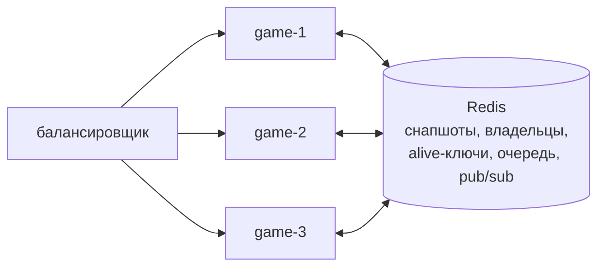

# Несколько узлов

Несколько игровых серверов работают как один: общая очередь матчмейкинга, переадресация
игрока на узел, где идёт его матч, и перехват матчей упавшего узла. Вся координация идёт
через тот же Redis, где лежат снапшоты, отдельного сервиса нет. Код в
[`internal/cluster`](../internal/cluster) и [`internal/store/cluster.go`](../internal/store/cluster.go).

Включается флагами `-redis`, `-node-id` и `-public-url` (у каждого узла свои id и адрес).
Демо на трёх узлах — `docker-compose.cluster.yml` и `scripts/cluster-failover.sh`.

## Живость и владение

- **Живость.** Каждый узел раз в `lease/3` продлевает **один** ключ `alive:<node>` с TTL
  `-lease` (10 с). Цена не растёт с числом матчей.
- **Владение.** У каждого матча есть ключ `owner:<id>`. Сохранение и удаление снапшота —
  Lua-скрипты, которые отказывают, если владелец другой (`ErrNotOwner`). Узел, получивший
  отказ, перестаёт вести матч.
- **Перехват.** Живые узлы раз в 2 с ищут узлы с истёкшим `alive`. За мёртвый узел берётся
  один перехватчик (`SET NX` с TTL) и забирает не больше `AdoptBatch` матчей за проход:
  владелец каждого переписывается Lua-скриптом, проверяющим старого владельца, а матч
  поднимается из снапшота. Следующие проходы и другие узлы забирают остальное, поэтому
  нагрузка мёртвого узла расходится по живым, а один матч никогда не достаётся двоим.
- **Самоограничение.** Узел, который дольше `lease` не может продлить свой ключ (например,
  потерял Redis), сам останавливает свои матчи: их вот-вот заберут другие. Если он был
  просто отрезан и вернулся, проверка владельца отклонит его записи.
- **Выкатка без потерь.** При штатной остановке узел пишет финальные снапшоты и сразу
  удаляет свой `alive`-ключ. Соседи забирают его матчи на следующем проходе (≈2 с), не
  дожидаясь истечения аренды.

После перехвата игроки переподключаются через балансировщик. Узел, у которого матча нет,
отвечает `wrong_server` с адресом нового владельца, и клиент делает `resume` там.
Восстановленный матч стоит на паузе, пока оба игрока не вернутся. Время отсутствия во
время перехвата в бюджет паузы не засчитывается.

## Общий матчмейкинг

- Заявка `<id>\t<node>\t<name>` кладётся в общий список Redis.
- Любой узел атомарно (одним Lua-скриптом) снимает двух самых старых игроков, пропуская
  заявки мёртвых узлов, и создаёт матч у себя: он жив, значит, может его вести.
- Каждый игрок узнаёт о матче. Игрок того же узла — напрямую, игрок другого узла — через
  pub/sub-канал своего узла. Он получает `matched` с полем `url` и переподключается к
  узлу-хозяину через `resume`.
- Pub/sub доставляет сообщение не больше одного раза. Если назначение потерялось (узел,
  снявший пару, упал между снятием и публикацией), узел игрока замечает, что его заявки
  нет ни в очереди, ни в назначениях, и ставит её снова. Брошенный матч заканчивается
  `opponent_never_joined`.

## Гарантии и границы

| Ситуация | Что происходит |
|---|---|
| Узел упал (SIGKILL, обрыв питания) | Через `lease` + проход перехвата (≈12 с) его матчи живы на других узлах. Теряется прогресс после последнего снапшота (не больше 1 с). |
| Узел штатно выключен (SIGTERM, выкатка) | Финальные снапшоты, матчи переезжают за ≈2 с, прогресс не теряется. |
| Узел отрезан от Redis | Через `lease` он сам останавливает свои матчи, их забирают другие. Вернувшись, он не может перезаписать чужое. |
| Redis недоступен меньше `lease` | Игра не замечает: цикл матча не ждёт Redis, снапшоты пропускаются (circuit breaker), матчмейкинг ждёт. |
| Redis недоступен дольше `lease` | Узлы не могут доказать владение и останавливают свои матчи: при сетевом разделе это не даёт одному матчу идти на двух узлах. Когда Redis вернулся, каждый узел поднимает свои матчи из последних снапшотов, а игроки возвращаются через `resume`. Это выбор безопасности против доступности, проверен тестом `TestLeaseLossStopsAndRecoveryRestores`. |
| Два узла считают себя владельцами | Невозможно: запись проходит только у владельца из Redis, остальные получают `ErrNotOwner` и останавливают матч. |

Ограничения: Lua-скрипты обращаются к ключам разных слотов, поэтому нужен один Redis (или
primary под Sentinel), а не Redis Cluster. Порядок выдачи из общей очереди — FIFO, без
рейтинга.

## Как проверено

- **Хранилище** (`internal/store/cluster_test.go`, miniredis): перехват после истечения
  аренды, зомби-владелец получает `ErrNotOwner` и не восстанавливает чужое, пачки
  перехвата, два перехватчика никогда не берут один матч, мгновенный перехват после
  `Release`.
- **Матчмейкер** (`internal/cluster/matchmaker_test.go`): пара игроков с разных узлов
  (у одного `url` хозяина), пропуск заявок мёртвого узла, `Leave`, повторная постановка
  потерянного назначения, вывод узла из очереди.
- **Сквозной тест** (`internal/server/cluster_test.go`): два настоящих сервера. Игроки
  заходят через разные узлы и попадают в один матч. Узел-хозяин «падает» посреди раунда,
  второй узел перехватывает матч, оба игрока возвращаются через него, использованный до
  падения `seq` по-прежнему отбрасывается, и матч доигрывается до `match_over`.

## Демо: узел убит под нагрузкой

`scripts/cluster-failover.sh`: три узла и Redis в Docker, 300 пар ботов (бинарный
протокол) заходят через все три узла, как через балансировщик, и следуют редиректам. На
35-й секунде `game-2` убивается по **SIGKILL**, без штатной остановки. Боты с
`-resume-on-drop` переподключаются через любой узел и делают `resume`, а их проверяющая
часть следит за инвариантами протокола всё время. Сырые данные — в
[`docs/loadtest/cluster/`](loadtest/cluster/).

| Метрика | Значение |
|---|---:|
| Матчей на упавшем узле | 88 (176 игроков) |
| **Игроков вернулись в свой матч** | **176 из 176 (100 %)** |
| Потеряно матчей | 0 |
| Время от обрыва до продолжения матча p50 / p95 / max | 9,3 / 12,6 / 13,1 с |
| Перехват | `game-3` — 50 матчей, `game-1` — 38 (пачками по 50) |
| Ошибок / обрывов за прогон | 0 / 0 |
| Нарушений инвариантов протокола | 0 |
| Межузловых редиректов (`matched.url`, `wrong_server`) | 1574 |
| Input→ack p50 / p95 / p99 за прогон | 24,9 / 48,4 / 50,7 мс |

Время восстановления складывается из аренды (10 с, флаг `-lease`) и ближайшего прохода
перехвата (≤2 с). p95 12,6 с укладывается в окно переподключения 20 с. Меньшая аренда
ускоряет перехват, но повышает риск ложной «смерти» узла при паузах GC или сети.

Первый прогон этого демо нашёл два бага, исправленных до того, как получились цифры выше:

- **Редирект на мёртвый узел.** Пока матч не перехвачен, каталог владельцев указывал на
  упавший узел, и клиенты висели на подключении к исчезнувшему адресу до системного
  таймаута (≈24 с; 62 из 113 игроков не успели вернуться). Теперь каталог видит, что
  владелец мёртв, а сервер отвечает `match_moving` («повторите»).
- **Повтор номеров событий после отката.** Матч, поднятый из последнего снапшота,
  выдавал новым событиям номера, которые клиент уже видел у потерянных событий. Теперь
  счётчики после нефинального снапшота сдвигаются вперёд, а первый `resume` получает
  `eventsComplete=false`: доверять состоянию и переотправить неподтверждённые входы.
  Тест: `TestRestoreFromCrashSnapshotNeverReusesEventNumbers`.
