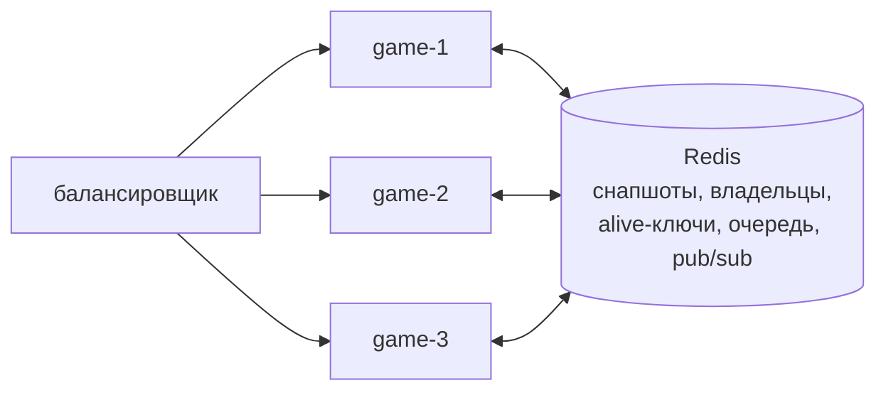

# Несколько узлов

Несколько игровых серверов работают как один: общая очередь матчмейкинга, переадресация
игрока на узел, где идёт его матч, и перехват матчей упавшего узла. Вся координация идёт
через тот же Redis, где лежат снапшоты, отдельного сервиса нет. Код в
[`internal/cluster`](../internal/cluster) и [`internal/store/cluster.go`](../internal/store/cluster.go).

Включается флагами `-redis`, `-node-id` и `-public-url` (у каждого узла свои id и адрес).
Демо на трёх узлах — `docker-compose.cluster.yml` и `scripts/cluster-failover.sh`.

## Живость и владение

- **Живость.** Каждый узел раз в `lease/3` продлевает **один** ключ `alive:<node>` с TTL
  `-lease` (10 с). Цена не растёт с числом матчей.
- **Владение.** У каждого матча есть ключ `owner:<id>`. Сохранение и удаление снапшота —
  Lua-скрипты, которые отказывают, если владелец другой (`ErrNotOwner`). Узел, получивший
  отказ, перестаёт вести матч.
- **Перехват.** Живые узлы раз в 2 с ищут узлы с истёкшим `alive`. За мёртвый узел берётся
  один перехватчик (`SET NX` с TTL) и забирает не больше `AdoptBatch` матчей за проход:
  владелец каждого переписывается Lua-скриптом, проверяющим старого владельца, а матч
  поднимается из снапшота. Следующие проходы и другие узлы забирают остальное, поэтому
  нагрузка мёртвого узла расходится по живым, а один матч никогда не достаётся двоим.
- **Самоограничение.** Другие узлы вправе забрать матчи, как только истёк `alive`-ключ, то
  есть через `lease` после того, как был **отправлен** последний удачный heartbeat. Поэтому
  узел, который не может продлить ключ (например, потерял Redis), останавливает свои
  матчи раньше: через 2/3 `lease` от момента отправки. Ни один heartbeat не ждёт ответа
  дольше этого срока. Оставшаяся треть аренды — запас на планировщик и разницу хода часов.
  Heartbeat идёт в отдельной горутине, поэтому медленный проход перехвата или `Restore`
  его не задерживает. Если узел был просто отрезан и вернулся, проверка владельца отклонит
  его записи.
- **Выкатка без потерь.** При штатной остановке узел сначала помечает свой `alive`-ключ как
  уходящий. Он ещё жив, его матчи никто не забирает, но игроков к нему больше не
  направляют: соседи отвечают `match_moving`, и клиент повторяет `resume`. Затем узел пишет
  финальные снапшоты и удаляет ключ. Соседи забирают его матчи на следующем проходе
  (≈2 с), не дожидаясь истечения аренды.

После перехвата игроки переподключаются через балансировщик. Узел, у которого матча нет,
отвечает `wrong_server` с адресом нового владельца, и клиент делает `resume` там.
Восстановленный матч стоит (`state.paused`), пока не вернутся оба игрока, но не дольше
`-resync-wait` (10 с): иначе раунд выигрывал бы тот, чей клиент первым нашёл новый узел.
Оба места отключены, и у каждого игрока обычное окно переподключения (20 с) от момента
перехвата; стоянка его не продлевает. У игрока, который
отключился ещё до падения узла, сохраняется оставшаяся часть окна. Время, пока матч никто
не вёл (от последнего снапшота до перехвата), не засчитывается никому: дедлайны и окно
сдвигаются на него. Тест — `TestTakeoverWithAwayPlayer`.

## Общий матчмейкинг

- Заявка `<id>\t<node>\t<хэш токена>\t<name>` кладётся в общий список Redis. Сессионный
  токен игрока создаёт его узел и хранит у себя. В Redis (очередь, записи назначений,
  pub/sub) попадает только хэш, а матч и так хранит только его. Ключ очереди версионирован
  (`mm:queue:v2`): при выкатке, меняющей формат заявки, старые и новые узлы подбирают пары
  в разных очередях и не путают заявки друг друга.
- Любой узел атомарно (одним Lua-скриптом) снимает двух самых старых игроков, пропуская
  заявки мёртвых узлов, и создаёт матч у себя: он жив, значит, может его вести.
- Каждый игрок узнаёт о матче. Игрок того же узла — напрямую, игрок другого узла — через
  pub/sub-канал своего узла. Он получает `matched` с полем `url` и переподключается к
  узлу-хозяину через `resume`.
- Pub/sub доставляет сообщение не больше одного раза, поэтому это только быстрый путь.
  Lua-скрипт, снимающий пару, атомарно записывает claim на каждую заявку («снял узел X»),
  а узел-хозяин сохраняет назначение в Redis **до** публикации. Узел, чья заявка пропала из
  очереди без сообщения, проверяет:
  - назначение записано — сообщение потерялось или опаздывает, отдаём игроку запись;
  - claim есть и его узел жив — тот ещё создаёт матч, ждём;
  - узел мёртв или claim истёк, а назначения нет — матч так и не объявили, ставим заявку
    снова.

  Поэтому игрок не попадает в два матча из-за медленного сообщения, а заявка не теряется,
  если узел упал между снятием пары и объявлением матча.

## Гарантии и границы

| Ситуация | Что происходит |
|---|---|
| Узел упал (SIGKILL, обрыв питания) | Через `lease` + проход перехвата (≈12 с) его матчи живы на других узлах. Теряется прогресс после последнего снапшота (не больше 1 с). |
| Узел упал сразу после создания матча | Пока Redis доступен, матч не теряется: игроки узнают о нём (`matched`) только после того, как его первый снапшот и владелец записаны в Redis. Эта запись идёт вне очереди периодических снапшотов. Если Redis недоступен, матч всё равно начинается, но без сохранённой копии: отказываться играть из-за Redis хуже. Запись повторяется на следующем тике снапшотов. |
| Выкатка меняет формат снапшота | Снапшот неизвестной версии никогда не удаляется: узел, который не умеет его запустить, оставляет его в Redis. Перехват смотрит версию до переноса владения, поэтому матч достаётся только узлу, который может его вести. Старые версии поднимаются через цепочку миграций (`snapshotMigrations`). Обратное не работает: матч узла новой версии может перехватить только узел той же или более новой версии. Если обновлённый узел упадёт, пока живы только старые, его матчи ждут в Redis (до `-redis-ttl`, 1 ч) подъёма узла новой версии, а игроки этих матчей проигрывают по окну переподключения. Поэтому выкатку, повышающую версию снапшота, начинают сразу с двух узлов, а не с одного. |
| Узел штатно выключен (SIGTERM, выкатка) | Финальные снапшоты, матчи переезжают за ≈2 с, прогресс не теряется. |
| Узел отрезан от Redis | Через 2/3 `lease` он сам останавливает свои матчи, до того как их могут забрать другие. Вернувшись, он не может перезаписать чужое. |
| Redis недоступен меньше `lease` | Игра не замечает: цикл матча не ждёт Redis, снапшоты пропускаются (circuit breaker), матчмейкинг ждёт. |
| Redis недоступен дольше `lease` | Узлы не могут доказать владение и останавливают свои матчи: при сетевом разделе это не даёт одному матчу идти на двух узлах. Когда Redis вернулся, каждый узел поднимает свои матчи из последних снапшотов, а игроки возвращаются через `resume`. Это выбор безопасности против доступности, проверен тестом `TestLeaseLossStopsAndRecoveryRestores`. |
| Два узла считают себя владельцами | Данные не портятся: запись проходит только у владельца из Redis, остальные получают `ErrNotOwner` и останавливают матч. Чтобы матч не *шёл* на двух узлах, старый владелец останавливается за треть аренды до перехвата. Это верно, пока процесс не замирает дольше этого запаса (пауза VM, swap). Такая пауза ограничена записью: ходы на устаревшей копии теряются, но в хранилище не попадают. |

Ограничения: Lua-скрипты обращаются к ключам разных слотов, поэтому нужен один Redis (или
primary под Sentinel), а не Redis Cluster. Порядок выдачи из общей очереди — FIFO, без
рейтинга.

## Как проверено

- **Хранилище** (`internal/store/cluster_test.go`, miniredis): перехват после истечения
  аренды, зомби-владелец получает `ErrNotOwner` и не восстанавливает чужое, пачки
  перехвата, два перехватчика никогда не берут один матч, мгновенный перехват после
  `Release`.
- **Матчмейкер** (`internal/cluster/matchmaker_test.go`): пара игроков с разных узлов
  (у одного `url` хозяина), пропуск заявок мёртвого узла, `Leave`, повторная постановка
  потерянного назначения, вывод узла из очереди. В `defects_test.go`: назначение без
  pub/sub-сообщения доставляется из записи, заявка живого медленного узла не
  переставляется, а мёртвого — переставляется.
- **Узел** (`internal/cluster/node_test.go`, `defects_test.go`): остановка матчей до
  истечения аренды, когда Redis перестал отвечать; heartbeat не ждёт медленного прохода
  перехвата; восстановление своих матчей после возврата Redis.
- **Сквозной тест** (`internal/server/cluster_test.go`): два настоящих сервера. Игроки
  заходят через разные узлы и попадают в один матч. Узел-хозяин «падает» посреди раунда,
  второй узел перехватывает матч, оба игрока возвращаются через него, использованный до
  падения `seq` по-прежнему отбрасывается, и матч доигрывается до `match_over`.

## Демо: узел убит под нагрузкой

`scripts/cluster-failover.sh [пары] [секунда] [SIGKILL|SIGTERM]`: три узла и Redis в
Docker, 300 пар ботов (бинарный протокол) заходят через все три узла, как через
балансировщик, и следуют редиректам. На 35-й секунде `game-2` останавливается. Боты с
`-resume-on-drop` переподключаются через любой узел и делают `resume`, а их проверяющая
часть всё время следит за инвариантами протокола. Сырые данные лежат в
[`docs/loadtest/cluster/`](loadtest/cluster/).

Два сценария, оба прогнаны на текущей версии кластера:

- **SIGKILL** — падение: финальных снапшотов нет, матчи откатываются к последнему
  периодическому и переезжают после истечения аренды.
- **SIGTERM** — выкатка: узел помечает себя уходящим, пишет финальные снапшоты, снимает
  `alive`-ключ и выходит.

| Метрика | SIGKILL (падение) | SIGTERM (выкатка) |
|---|---:|---:|
| Игроков на остановленном узле | 188 (94 матча) | 206 (103 матча) |
| **Вернулись в свой матч** | **188 из 188** | **206 из 206** |
| Потеряно матчей | 0 | 0 |
| От обрыва до продолжения матча p50 / p95 / max | 12,9 / 12,9 / 13,4 с | 3,8 / 3,9 / 3,9 с |
| Перехват | `game-1` — 50, `game-3` — 44 | `game-1` — 50, `game-3` — 53 |
| Ошибок / обрывов за прогон | 0 / 0 | 0 / 0 |
| Нарушений инвариантов протокола | 0 | 0 |
| Межузловых редиректов | 1520 | 973 |
| Input→ack p50 / p95 / p99 за прогон | 25,5 / 48,3 / 50,3 мс | 26,2 / 48,3 / 50,4 мс |

При **падении** время восстановления складывается из остатка аренды и ожидания ближайшего
прохода перехвата (≤2 с). Аренда истекает через 10 с (`-lease`) после последнего
heartbeat, а heartbeat уходит раз в 3,3 с. Поэтому, в зависимости от того, когда узел
упал, восстановление занимает от ≈7 до ≈13 с (плюс повтор клиента раз в 0,5 с). Три
прогона на разных версиях кода дали p95 12,6 с (176 из 176), 8,7 с (192 из 192) и 12,9 с
(188 из 188). Это разброс момента падения относительно
heartbeat, а не эффект исправлений. Всё укладывается в окно переподключения 20 с. Меньшая
аренда ускоряет перехват, но повышает риск ложной «смерти» узла при паузах GC или сети.

При **выкатке** аренда не ждётся: финальные снапшоты 103 матчей записаны за 22 мс, и
соседи забрали матчи в ближайшем проходе. Пока узел уходил, игроков к нему не отправляли:
соседи отвечали `match_moving`, и клиенты повторяли `resume` раз в 0,5 с. Прогресс не
теряется, потому что снапшоты финальные.

Первый прогон этого демо нашёл два бага, исправленных до того, как получились цифры выше:

- **Редирект на мёртвый узел.** Пока матч не перехвачен, каталог владельцев указывал на
  упавший узел, и клиенты висели на подключении к исчезнувшему адресу до системного
  таймаута (≈24 с; 62 из 113 игроков не успели вернуться). Теперь каталог видит, что
  владелец мёртв, а сервер отвечает `match_moving` («повторите»).
- **Повтор номеров событий после отката.** Матч, поднятый из последнего снапшота,
  выдавал новым событиям номера, которые клиент уже видел у потерянных событий. Теперь
  счётчики после нефинального снапшота сдвигаются вперёд, а первый `resume` получает
  `eventsComplete=false`: доверять состоянию и переотправить неподтверждённые входы.
  Тест: `TestRestoreFromCrashSnapshotNeverReusesEventNumbers`.
