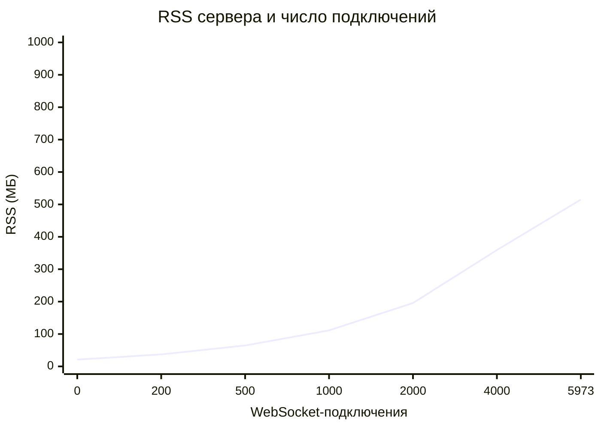
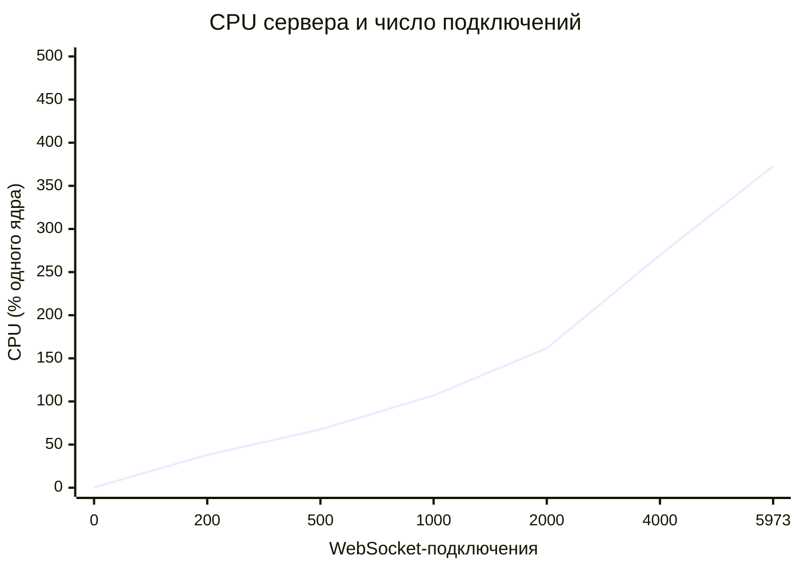
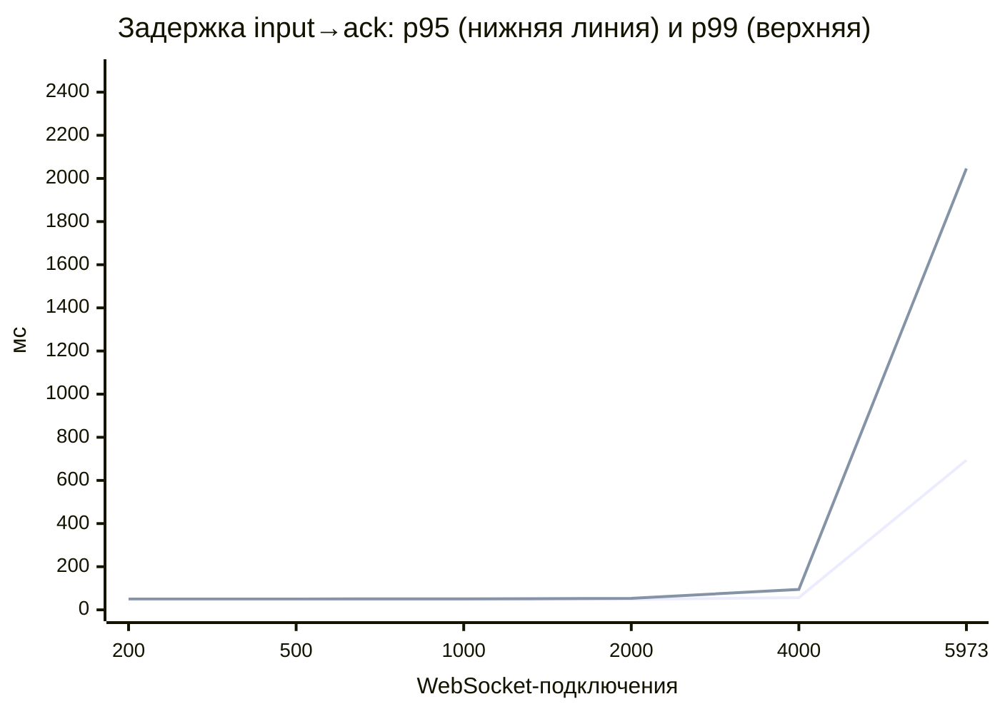
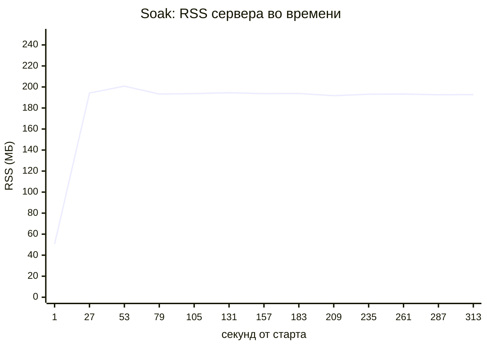
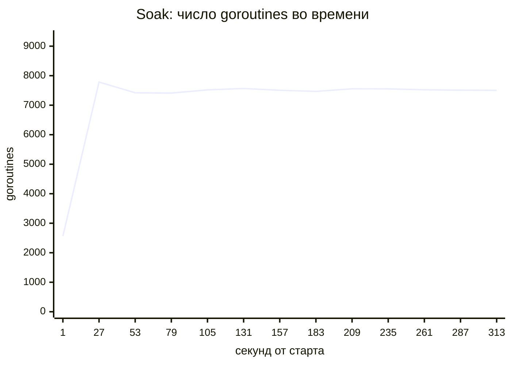

# Нагрузочное тестирование

Здесь описано, как я нагружал сервер на одном ноутбуке, и что показали измерения. Каждое
число в таблицах и графиках взято из прогона, который действительно был выполнен.

- Сырые результаты лежат в [`docs/loadtest/`](loadtest/). На каждый прогон есть
  JSON-файл с итогами и посекундными снимками `/metrics`, а консольный вывод сохранён в
  `console-*.txt`.
- Таблицы и графики между маркерами `<!-- gen:… -->` сгенерированы из этих файлов
  командой `go run ./cmd/loadreport`. Остальной текст написан вручную по тем же числам.

## Кратко

> Ступенчатая нагрузка, soak и шторм ниже сняты на версии **до** [укрепления](HARDENING.md). Сравнение с текущей версией — в разделе [«Сравнение до и после укрепления»](#сравнение-до-и-после-укрепления): CPU тот же, памяти на 5–7 % меньше.

- **Ступенчатая нагрузка до 3000 пар (6000 WebSocket-подключений, ≈3000 одновременных
  матчей).**
  - До 2000 пар (4000 подключений) включительно ошибок и обрывов нет. p95 задержки
    input→ack 48–56 мс, p99 не выше 95 мс. Почти всё это время — намеренное ожидание
    50-миллисекундного тика.
  - На 3000 парах общая машина упёрлась в CPU: p95 694 мс, p99 2 с, один обрыв
    соединения.
- **Память растёт линейно**, примерно **83 КБ RSS на подключение** (≈166 КБ на матч из
  двух игроков). На 4000 подключениях сервер занимал 359 МБ.
- **Ограничитель — CPU, а не память.** На 4000 подключениях сервер использовал 2,7
  ядра. Прирост на высоких ступенях ≈0,055 % одного ядра на подключение, то есть одно
  ядро ≈ 1800 подключений.
- **Soak 1000 пар × 5 минут.** RSS 180 → 193 МБ (максимум 201), goroutines 7355 → 7487.
  Ни роста памяти, ни утечки goroutines не видно. 15 047 матчей завершены без ошибок.
- **Шторм переподключений:** 200 из 1000 клиентов (20 %) одновременно оборвали сокет
  посреди матча и сделали `resume`. Восстановились **100 %**, p50 20 мс, максимум 35 мс.
- Остановился на 3000 парах **из-за насыщения CPU**, а не памяти: по проверкам до и после
  каждой ступени свободная память хоста не опускалась ниже 6,18 ГБ при пороге 2,5 ГБ. Ступень 5000 пар не запускал.
  Машина уже была перегружена, и её результаты показали бы конкуренцию с ботами, а не
  возможности сервера.

## Методика

### Железо и ОС

- Ноутбук: Intel Core i9-10885H (8 ядер / 16 потоков), 32 ГБ RAM, Windows 11.
- Все прогоны шли в **WSL2 Ubuntu**, у которой **8 vCPU** и около 8 ГБ памяти.
- Linux-бинарники собраны кросс-компиляцией из Windows, Go 1.27.4
  (`GOOS=linux CGO_ENABLED=0`).
- **Машина не простаивала.** На том же хосте шла другая важная нагрузка. Перед soak-тестом,
  когда ни сервер, ни бот не работали, load average виртуальной машины WSL2 был ≈29
  (см. `console-soak.txt`). Значит, часть CPU всё время забирал чужой процесс. Все
  CPU-показатели и задержки ниже получены в таких условиях.
- Перед каждой ступенью скрипт проверял свободную физическую память хоста (Windows) и
  должен был остановить рост нагрузки, если её меньше 2,5 ГБ. Docker и Redis не
  запускались.

### Ограничение: сервер и боты на одной машине

`cmd/server` и `cmd/bot` работали **на одних и тех же 8 vCPU** и общались через loopback.
Бот сам тратит много CPU: он декодирует JSON каждого кадра `state` на тысячах сокетов, и
на верхних ступенях это ≈2 ядра. Поэтому на высокой нагрузке сервер конкурирует с
собственным генератором нагрузки и с чужим процессом, и задержки там **пессимистичны для
сервера**. С другой стороны, у loopback нет реальной сетевой задержки, потерь пакетов и
TLS. Многомашинный тест это не заменяет.

### Настройки сервера

Сервер запускался со значениями по умолчанию (`cmd/server -log-level warn`):

| Параметр | Значение |
|---|---|
| Серверный тик (проверка таймеров, рассылка `state` не чаще раза за тик) | 50 мс (20 Гц) |
| Гравитация | 500 мс |
| Отсчёт / пауза после раунда | 3 с / 3 с |
| Таймер раунда | 90 с |
| Окно переподключения / таймаут бездействия | 20 с / 30 с |
| Linger после конца матча (для поздних `resume`) | 10 с |
| Хранилище снапшотов | в памяти, снапшот каждого матча раз в 1 с |

### Поведение ботов (`cmd/bot`)

- Ступень запускает **N пар** (2N WebSocket-клиентов), по одному клиенту раз в 1 мс.
- Каждый бот отправляет `join`, получает соперника и играет до `match_over`. После этого
  закрывает сокет, переподключается и снова встаёт в очередь (режим `-duration`). Число
  подключений поэтому почти постоянно, а матчмейкинг, создание и завершение матчей входят
  в нагрузку.
- Пока его матч в фазе `playing` и не на паузе, бот шлёт **10 входов в секунду**:
  случайное действие плюс дополнительный шанс 1/3 на `hard_drop`, чтобы раунды
  заканчивались.
- **Случайная фаза внутри тика.** Матч создаётся в момент входа второго игрока. Обычный
  100-миллисекундный тикер, запущенный в этот момент, шёл бы синхронно с 50-миллисекундным
  тиком сервера, и задержка выглядела бы либо почти нулевой, либо равной целому тику.
  Поэтому первый вход каждого матча бот делает со случайным смещением из `[0, 100 мс)`.
- Каждая ступень: **15 с разогрева после запуска всех ботов, затем 60 с измерения**.
  Учитывается только окно измерения.

### Что и как измерялось

| Метрика | Источник |
|---|---|
| Задержка input→ack | На стороне бота: от отправки `input` с `seq = n` до первого `state` с `ack ≥ n`. Каждый вход в окне — отдельный замер. Сюда входит намеренная пакетная рассылка раз в тик: в среднем полтика, максимум один тик. |
| WebSocket-подключения | Gauge сервера `sabostack_connected_players`, опрос `/metrics` раз в 1 с. Среднее и минимум за окно. |
| Живые матчи | Gauge `sabostack_live_matches` (матчи, которые ещё не закончились). `sabostack_active_matches` дополнительно считает завершённые матчи в периоде linger. |
| RSS сервера | `process_resident_memory_bytes` из process collector Prometheus (читает `/proc/self/stat`). Среднее и максимум за окно. Пиковое значение `VmHWM` из `/proc/<pid>/status` есть в `console-*.txt`. |
| CPU сервера, % | `Δ process_cpu_seconds_total / Δ реального времени` между первым и последним опросом окна. 100 % = одно ядро целиком. |
| Goroutines | `go_goroutines`, среднее за окно. |
| Тик: среднее / максимум | Среднее = `Δ sabostack_tick_duration_seconds_sum / Δ _count` за окно. Максимум = `sabostack_tick_duration_max_seconds`, самый долгий тик с начала процесса, включая разгон. |
| Сообщений/с | Кадры, полученные всеми ботами за окно, делённые на его длину. |
| Ошибки / обрывы | На стороне бота. Ошибка — неудачный dial или кадр `error` от сервера. Обрыв — сервер закрыл сокет раньше `match_over`. |
| CPU и память бота | `/usr/bin/time -f "%M %U %S"`, в `console-*.txt`. |

Каждая ступень запускалась на свежем процессе сервера. В конце сервер получал SIGTERM и
проходил полную штатную остановку со снапшотами. Все остановки завершились с кодом 0 и
без строк `ERROR` в логе, самая долгая заняла 0,26 с (6000 подключений). Опрос `/metrics`
раз в секунду входит в измеренный CPU сервера, а ступень 0 показывает его стоимость.

Как повторить одну ступень (Linux или WSL2):

```sh
GOOS=linux GOARCH=amd64 CGO_ENABLED=0 go build -o bin/linux/ ./cmd/...
scripts/loadtest-step.sh 500 60s ramp-0500        # сервер + бот, результат в docs/loadtest/ramp-0500.json
scripts/loadtest-step.sh 1000 300s soak           # soak
scripts/loadtest-step.sh 500 60s storm -storm-at 20s -storm-frac 0.2
go run ./cmd/loadreport                           # перегенерировать таблицы и графики ниже
```

## Ступенчатая нагрузка

<!-- gen:ramp-table -->
| Пар | WS-подключений (сред. / мин.) | Живых матчей (сред.) | RSS сервера, МБ (сред. / макс.) | CPU сервера, % одного ядра | Goroutines (сред.) | Input→ack p50 / p95 / p99 / max (мс) | Тик: среднее мкс / макс. мс | Сообщений/с | Входов отправлено | Ошибок / обрывов |
|---:|---:|---:|---:|---:|---:|---:|---:|---:|---:|---:|
| 0 | 0 / 0 | 0 | 21.0 / 22.5 | 0.3 | 10 | – | 0.0 / 0.00 | 0 | 0 | 0 / 0 |
| 100 | 200 / 200 | 100 | 37.1 / 40.1 | 38.0 | 761 | 26.3 / 48.3 / 50.4 / 52.1 | 3.1 / 1.79 | 896 | 28196 | 0 / 0 |
| 250 | 500 / 499 | 250 | 64.6 / 67.9 | 67.6 | 1888 | 25.2 / 48.4 / 50.5 / 63.4 | 3.1 / 5.99 | 2244 | 71379 | 0 / 0 |
| 500 | 1000 / 996 | 500 | 111.3 / 114.7 | 107.0 | 3766 | 26.1 / 48.5 / 50.8 / 89.1 | 5.2 / 19.60 | 4491 | 143946 | 0 / 0 |
| 1000 | 2000 / 1998 | 1000 | 195.6 / 198.0 | 161.7 | 7517 | 26.2 / 48.8 / 53.6 / 143.8 | 8.3 / 43.64 | 9111 | 293691 | 0 / 0 |
| 2000 | 4000 / 3996 | 2000 | 359.1 / 361.1 | 269.7 | 15031 | 28.0 / 56.4 / 94.5 / 275.8 | 18.4 / 174.64 | 18446 | 595697 | 0 / 0 |
| 3000 | 5973 / 5864 | 2955 | 514.9 / 517.3 | 373.0 | 22362 | 69.9 / 693.7 / 2046.1 / 5243.6 | 55.6 / 403.51 | 26551 | 836467 | 0 / 1 |
<!-- /gen -->

Пояснения:

- **Задержка до 4000 подключений почти не меняется.** p50 ≈ 26 мс — это половина тика.
  p95 ≈ 48 мс — почти целый тик. Хвост p99 и максимум растут, когда CPU начинает делиться
  с ботами.
- **3000 пар — точка насыщения.** Сервер занимал 3,7 ядра, бот ≈2 ядра, плюс чужая
  нагрузка на той же виртуальной машине. Goroutines перестали получать процессор вовремя:
  тик доходил до 404 мс, p99 до 2 с, один сокет оборвался. Матчи при этом продолжали
  завершаться (8356 за 60 с), но игровой опыт на такой задержке неприемлем.
- **Максимальный тик** (1,8 мс на 100 парах, 175 мс на 2000) растёт быстрее среднего.
  Скорее всего, это вытеснение goroutine планировщиком при общей загрузке машины, а не
  стоимость игровой логики: среднее время тика остаётся 3–18 мкс. Профилирование не
  проводилось, так что это гипотеза.

### RSS сервера и число подключений

<!-- gen:chart-rss -->

<!-- /gen -->

### CPU сервера и число подключений

<!-- gen:chart-cpu -->

<!-- /gen -->

### Задержка input→ack (p95 и p99) и число подключений

<!-- gen:chart-latency -->

<!-- /gen -->

## Ёмкость

<!-- gen:slopes -->
Линейная регрессия (МНК) по всем 7 шагам, x = среднее число WebSocket-подключений:

- **RSS ≈ 24.3 МБ + 82.9 КБ × подключения**
- **CPU ≈ 29.7 % + 0.059 % одного ядра × подключения**
<!-- /gen -->

Регрессия по всем точкам годится для памяти: точки почти на прямой. Для CPU она хуже:
рост нелинейный. На малой нагрузке подключение стоит дороже (0,19 % ядра на 200
подключениях), видимо из-за фиксированной цены пробуждения goroutine и опроса метрик. На
высоких ступенях стоимость стабилизируется. Поэтому для оценки беру **предельный
прирост, измеренный между соседними ступенями**:

| Отрезок | Δ подключений | Δ RSS | Δ CPU | На одно подключение |
|---|---:|---:|---:|---|
| 500 → 1000 пар | +1000 | +84,3 МБ | +54,7 % | 84 КБ, 0,055 % ядра |
| 1000 → 2000 пар | +2000 | +163,5 МБ | +108,0 % | 82 КБ, 0,054 % ядра |

**Стоимость одного подключённого игрока** при тике 50 мс и 10 входах в секунду:
**≈ 82–84 КБ RAM и ≈ 0,055 % одного ядра**. Это примерно 1800 игроков (900 матчей) на
ядро. Каждый игрок получает в среднем ≈ 4,6 сообщения в секунду и ≈ 3,8 КБ/с (на 4000
подключениях: 18 446 сообщений/с и 920 МБ за 60 с).

**Оценка для машины 2 vCPU / 4 ГБ.** Это **экстраполяция** из измеренных точек, а не
измерение.

- **CPU.** Если держать сервер не выше ~70 % от двух ядер (140 % одного ядра), то по
  измеренным точкам (107 % на 1000 подключениях, 162 % на 2000) это **≈ 1500–1800
  подключений, то есть ≈ 750–900 одновременных матчей**.
- **Память.** Столько подключений займёт лишь ≈ 150–175 МБ RSS. По одной только памяти
  4 ГБ вместили бы на порядок больше (десятки тысяч подключений), так что **ограничивает
  CPU** с запасом более чем в 20 раз.
- **Оговорки.**
  - Сервер на отдельной машине не делит CPU с ботами, и это работает в плюс.
  - С другой стороны, у Go runtime будет всего 2 P, а настоящая сеть и TLS добавят
    системных вызовов и шифрования, которых не было на loopback.
  - Реальный клиент шлёт меньше 10 входов в секунду, а это тоже влияет на результат.
  - До проверки на целевой машине считаю цифру ориентиром с точностью «в пределах раза».

**Что видно как узкое место.** Наблюдал насыщение CPU всей машины. Память до
предела далеко. Очередь персистера видна в метрике `sabostack_persist_pending`. На этом стенде нельзя
отделить, сколько из ≈ 6 занятых ядер на 3000 парах приходится на сервер, сколько на бота
и сколько на чужую нагрузку. Профиль памяти снят (см. [HARDENING.md](HARDENING.md)),
профиль CPU — нет.

Гипотезы, где сервер можно удешевить (не проверены):

- кодировать `state` один раз на матч за тик, а не отдельно для каждого получателя
  (сейчас они отличаются только полем `ack`);
- реже снимать снапшоты;
- использовать бинарный протокол вместо JSON.

## Сравнение до и после укрепления

Та же методика, обе версии сервера на одном стенде. На каждой ступени версии идут подряд,
поэтому дрейф фоновой нагрузки хоста задевает обе одинаково (`scripts/loadtest-compare.sh`).
На 2000 и 3000 парах каждая версия прогнана трижды, в таблице медианы: на этих ступенях
хвост задержки от прогона к прогону гуляет сильнее, чем различается между версиями. Сырые
результаты лежат в [`docs/loadtest/hardening/`](loadtest/hardening/), что именно
изменилось — в [HARDENING.md](HARDENING.md).

<!-- gen:compare-hardening -->
| Пар | Версия | Прогонов | Input→ack p50 / p95 / p99 (мс) | CPU сервера, % ядра | RSS сервера, МБ (сред.) | Трафик на клиента, КБ/с | Матчей | Ошибок / обрывов |
|---:|---|---:|---:|---:|---:|---:|---:|---:|
| 500 | до | 1 | 26.2 / 48.4 / 50.3 | 92 | 111 | 3.63 | 1576 | 0 / 0 |
| 500 | после | 1 | 25.6 / 48.4 / 50.4 | 92 | 106 | 3.67 | 1573 | 0 / 0 |
| 1000 | до | 1 | 26.0 / 48.5 / 50.8 | 154 | 198 | 3.72 | 2997 | 0 / 0 |
| 1000 | после | 1 | 25.6 / 48.4 / 50.6 | 150 | 187 | 3.71 | 2993 | 0 / 0 |
| 2000 | до | 3 | 27.6 / 51.6 / 85.1 | 253 | 361 | 3.73 | 5947 | 0 / 0 |
| 2000 | после | 3 | 28.2 / 61.7 / 132.4 | 255 | 339 | 3.72 | 5893 | 0 / 0 |
| 3000 | до | 3 | 32.9 / 120.7 / 229.4 | 328 | 515 | 3.62 | 8934 | 0 / 0 |
| 3000 | после | 3 | 32.1 / 96.0 / 198.1 | 330 | 479 | 3.64 | 8994 | 0 / 0 |
| 500 (шторм) | до | 1 | 25.8 / 48.3 / 50.4 | 94 | 111 | 3.66 | 1564 | 0 / 0 |
| 500 (шторм) | после | 1 | 25.7 / 48.3 / 50.3 | 94 | 106 | 3.69 | 1566 | 0 / 0 |
<!-- /gen -->

Что видно:

- **Ошибок и обрывов нет ни в одном из 18 прогонов** обеих версий, включая шторм
  переподключений.
- **Память меньше на 5–7 %** (на 3000 парах 479 против 515 МБ): очереди входов и
  исходящих сообщений больше не держат заранее выделенные буферы на каждый матч и
  подключение. Как это нашлось, описано в [HARDENING.md](HARDENING.md#память-что-показал-профиль).
- **CPU одинаковый** в пределах 1–2 %. Rate limit, бюджет паузы, проверка смены фазы
  после каждого шага и несколько персистеров ничего не стоят на этом уровне нагрузки.
- **Задержка до 1000 пар совпадает.** На 2000 и 3000 парах разброс между прогонами одной
  версии больше, чем разница между версиями: на 2000 парах p95 старой версии
  51–63 мс, новой 51–82 мс, на 3000 парах наоборот (старая 101–140 мс, новая 91–112 мс).
  Load average хоста в этих прогонах был 30–36 на 8 vCPU. Вывод: по задержке разницы,
  измеримой на этом стенде, нет.
- Трафик тот же (3,6–3,7 КБ/с на клиента): протокол на этом этапе не менялся.

## Сравнение протоколов: JSON и бинарный

Один и тот же сервер, четыре варианта подряд на каждой ступени
(`scripts/loadtest-variants.sh`), на 2000 и 3000 парах по два прогона (медианы):

- **JSON, до этапа** — сервер до бинарного протокола и кластера;
- **JSON** — текущий сервер, JSON-клиенты;
- **бинарный, полные кадры** — текущий сервер с `-binary-full-frames`: сам формат без дельт;
- **бинарный, дельты** — текущий сервер, бинарные клиенты.

Бот во всех вариантах один и тот же и делает работу настоящего клиента: разбирает каждый
кадр целиком, вместе с полями, и проверяет инварианты протокола. Трафик — байты, которые
боты получили от сервера. Разбор — в [WIRE.md](WIRE.md#под-нагрузкой).

<!-- gen:compare-wire -->
| Пар | Версия | Прогонов | Input→ack p50 / p95 / p99 (мс) | CPU сервера, % ядра | RSS сервера, МБ (сред.) | Трафик на клиента, КБ/с | Матчей | Ошибок / обрывов | Нарушений |
|---:|---|---:|---:|---:|---:|---:|---:|---:|---:|
| 1000 | JSON, до этапа | 1 | 27.0 / 50.2 / 89.0 | 180 | 185 | 3.64 | 3036 | 0 / 0 | 0 |
| 1000 | JSON | 1 | 26.7 / 49.4 / 62.8 | 171 | 191 | 3.65 | 3020 | 0 / 0 | 0 |
| 1000 | бинарный, полные кадры | 1 | 26.1 / 48.5 / 50.8 | 158 | 205 | 1.01 | 3010 | 0 / 0 | 0 |
| 1000 | бинарный, дельты | 1 | 26.0 / 48.6 / 51.8 | 162 | 201 | 0.20 | 3015 | 0 / 0 | 0 |
| 2000 | JSON, до этапа | 2 | 38.3 / 234.5 / 623.9 | 291 | 332 | 3.64 | 5792 | 0 / 0 | 0 |
| 2000 | JSON | 2 | 35.7 / 161.3 / 402.4 | 269 | 350 | 3.72 | 5860 | 0 / 0 | 0 |
| 2000 | бинарный, полные кадры | 2 | 27.7 / 60.5 / 105.9 | 242 | 374 | 1.02 | 5934 | 0 / 0 | 0 |
| 2000 | бинарный, дельты | 2 | 29.1 / 84.1 / 151.1 | 247 | 374 | 0.20 | 5934 | 0 / 0 | 0 |
| 3000 | JSON, до этапа | 2 | 87.6 / 817.9 / 1357.6 | 338 | 480 | 3.66 | 8440 | 8 / 2 | 0 |
| 3000 | JSON | 2 | 37.0 / 153.8 / 364.3 | 312 | 500 | 3.65 | 8940 | 0 / 0 | 0 |
| 3000 | бинарный, полные кадры | 2 | 29.7 / 80.3 / 156.3 | 293 | 525 | 1.00 | 8988 | 0 / 0 | 0 |
| 3000 | бинарный, дельты | 2 | 37.8 / 135.0 / 243.2 | 314 | 523 | 0.20 | 8950 | 0 / 0 | 0 |
<!-- /gen -->

## Soak-тест

1000 пар (2000 подключений), 5 минут под нагрузкой, без перезапуска сервера:

<!-- gen:soak -->
| Метрика | Значение |
|---|---:|
| Пар / ботов | 1000 / 2000 |
| Длительность измерения | 300 с |
| Завершено матчей | 15047 |
| WS-подключений (сред. / мин.) | 2000 / 1998 |
| RSS сервера: начало → конец (макс.) | 179.9 → 192.6 МБ (200.8) |
| Goroutines: начало → конец (сред.) | 7355 → 7487 (7513) |
| CPU сервера | 173.0 % одного ядра |
| Input→ack p50 / p95 / p99 / max | 26.0 / 48.7 / 51.9 / 159.2 мс |
| Тик: среднее / макс. | 7.1 мкс / 66.20 мс |
| Ошибок / обрывов соединения | 0 / 0 |




<!-- /gen -->

RSS за 5 минут колеблется в пределах ≈ 180–201 МБ без тренда вверх. Число goroutines
держится около 7500. Колебания здесь — это матчи, которые как раз создаются или находятся
в периоде linger: по 3 goroutine на подключение плюс 1 на матч. Признаков утечки памяти
или goroutines нет. Пять минут — это короткий soak, многочасовой прогон не делался.

## Шторм переподключений

500 пар (1000 клиентов). Через 20 с после начала окна измерения 20 % ботов одновременно
закрывают свой сокет посреди матча, сразу открывают новый и отправляют `resume` с
`matchId`, токеном и `lastEventSeq`. Время восстановления считается от закрытия сокета
до получения `snapshot` на новом. Сюда входят новый TCP/WebSocket-handshake, `Attach` в
акторе и отправка снапшота с пропущенными событиями.

<!-- gen:storm -->
| Метрика | Значение |
|---|---:|
| Пар / ботов | 500 / 1000 |
| Выбрано ботов (20 %) | 200 |
| …из них были в матче (сокет оборван, затем resume) | 200 |
| …были между матчами или в очереди (пропущены) | 0 |
| Успешно восстановились | 200 (100.0 %) |
| Неудачно | 0 |
| Время восстановления (обрыв → snapshot) p50 / p95 / max | 20.2 / 27.5 / 35.1 мс |
| Ошибок / обрывов за прогон | 0 / 0 |
| Input→ack p99 / max за прогон | 51.1 / 118.8 мс |
<!-- /gen -->

Все 200 оборванных клиентов вернулись в свои матчи не позже чем за 35 мс. Окно
переподключения 20 с, так что до технического поражения было далеко. Ошибок и обрывов
за прогон нет, а задержка input→ack за прогон осталась
на уровне обычной ступени 500 пар.
